# ORG-STANDARD-002 — Background Processing & Workers

## Document Control

| Field | Value |
| --- | --- |
| **Standard ID** | ORG-STANDARD-002 |
| **Title** | Background Processing & Workers |
| **Version** | 2.11 |
| **Date** | 2026-08-31 |
| **Status** | Issued for Review |
| **Audience** | Solution Architects, Tech Leads, Senior Engineers implementing background workers in any BAPS system |
| **Author** | Principal Architect, BAPS |
| **Related Standards** | ORG-STANDARD-001 (Redis Auth Cache); ORG-STANDARD-003 (Workflow Orchestration & Sagas); ORG-STANDARD-004 (API Design & Standards) |

---

## Review & Approval

| # | Role | Reviewer | Signed | Date |
| --- | --- | --- | --- | --- |
| 1 | Author (Principal Architect) | Pratik Gohil | Pending | — |
| 2 | Security Lead | TBD on ratification | — | — |
| 3 | Infrastructure Lead | TBD on ratification | — | — |
| 4 | CTO / Engineering Director | TBD on ratification | — | — |

The standard is not enforceable until CTO approval. Amendments follow the same approval chain.

---

## Change Log

| Version | Date | Author | Summary |
| --- | --- | --- | --- |
| 1.0 | 2026-07-15 | Principal Architect | Initial issuance covering job classification, technology selection, retry/error handling, and job status API. |
| 1.1 | 2026-08-18 | Principal Architect | Fixed staleness found during a holistic 001-006 cross-standard audit: this document had never been revised since ORG-STANDARD-003 went from outline to fully issued, leaving 5 separate "ORG-STANDARD-003 — planned" references (Related Standards field, §4 Executive Summary ×2, §22 excluded-technologies table, §37.1/§38.1 tables) — all corrected to reflect 003's actual issued status, including confirming that 003's Airflow/WFS choice settles the Temporal-adoption question §4 had left open. Also fixed a fabricated citation in §22 ("deferred to ORG-STANDARD-003 / §37" — that section doesn't exist, and 003 doesn't cover Kafka Streams/Flink at any section), and added ORG-STANDARD-004 to the Related Standards field (already cited substantively in §11.6). |
| 1.2 | 2026-08-18 | Principal Architect | Fixed three internal contradictions from the same holistic audit: §8.1/§9.4's "no DLQ for Category 3" claim contradicted its own mandated Spring Batch guide (§26.3), which records skipped items to `background_job_dlq` — clarified as job-level (no DLQ, restartable via progress row) vs. item-level (skips recorded to DLQ) being two different granularities, not a contradiction; §30.5 permitted "fetched once at worker startup" with no refresh interval as a compliant flag-read option, which could leave a kill-switch inactive until a pod restart, contradicting Design Principle 4's "within seconds" guarantee — a ≤30-second refresh interval is now mandatory, not optional; §27.3's DLQ alert referenced a nonexistent "REPORTING" lane (the real five lanes are CRITICAL/TRANSACTIONAL/STANDARD/BULK/HOUSEKEEPING) and labeled itself "NOTIFY" while stating in its own parenthetical that it pages for two lanes — corrected to state PAGE/NOTIFY per lane explicitly, and restored the STANDARD lane the original wording had silently dropped. A fourth reported finding (a KEDA min-replica table at §14.1 allegedly disagreeing with the sample manifest and appendix) was investigated and did not reproduce against the actual document — no fix applied for that one. |
| 2.0 | 2026-08-18 | Principal Architect | **MAJOR — breaking schema change.** Fixed a real correctness bug from a holistic 001-006 audit, per an explicit decision to unify on `background_job.status`: §15.2's guard was presence-only against `background_job_idempotency` (key/job_id/first_seen_at/expires_at, no status column) — once a key was inserted, ANY redelivery, including a legitimate retry after a genuine transient failure, would be silently treated as "already done" and skipped, since presence alone can't distinguish success from failure. This directly contradicted the standard's own worked examples (§35.5, §39.2), which correctly check `background_job.status` for a terminal state before skipping. §15.2 now uses `background_job.job_key` (newly `UNIQUE`, §21.1) with a status-check on conflict (SUCCEEDED → skip; FAILED/DLQ → legitimate retry, reset to PENDING; PENDING/RUNNING → concurrent processing, skip) as the single canonical guard, matching what the worked examples already did. §14.4's dispatch-pipeline content dedup (recipient/template/time-window — a genuinely different concern from job-handler idempotency, since a dispatch can legitimately retry via a new job while still deduplicating against a recent send) keeps its own table, renamed from the now-repurposed `background_job_idempotency` to `message_dispatch_dedup` (§21.2) to make the separation explicit. The DBML schema (`org_standards/dbml/ORG-STANDARD-002-data-model.dbml`) is updated to match. This is a breaking change per this repo's own versioning rule (CLAUDE.md) — any system that already implemented the prior `background_job_idempotency` table as specified must migrate its schema and guard logic; hence MAJOR, not MINOR, despite landing alongside otherwise-MINOR fixes in the same session. |
| 2.1 | 2026-08-18 | Principal Architect | Fixed three terminology/consistency findings from the same holistic audit: §20.4's claim-check object-lifecycle TTL cited "the default retention window is 14 days" for the associated DLQ, but §21's own retention policy already mandates a 1-year minimum for `background_job_dlq` — the 14-day figure was stale and could leave a payload purged at day 14 while its DLQ row remained valid and replayable for up to a year; corrected to state the 1-year minimum directly. §33.3's runbook template listed "Slack channel or PagerDuty routing key" as interchangeable notification targets for any alert, with no severity-based distinction — added a cross-reference to ORG-STANDARD-006 §10.3's rule that PAGE-severity alerts specifically must target PagerDuty, while NOTIFY-severity alerts may use Slack. |
| 2.2 | 2026-08-18 | Principal Architect | Added new §14.7 Consent Enforcement, closing a six-standard-set gap identified during a holistic audit: no standard specified where in a dispatch pipeline a consent check must occur or what happens on failure. §14.7 requires the producer (not the worker) to check consent before enqueueing consent-gated content, with a mandatory re-check before send for long-queued BULK/HOUSEKEEPING dispatch where consent may have been withdrawn after enqueue. |
| 2.3 | 2026-08-18 | Principal Architect | Per explicit direction: §26.1's Hangfire setup previously banned SQL Server with no stated rationale. Reworded to state the actual policy — the organization has standardized on PostgreSQL wherever an RDBMS is needed; a small number of existing systems still on SQL Server are grandfathered, not newly compliant, and are expected to migrate opportunistically over time, not on a deadline this standard sets unilaterally. No new system may adopt SQL Server for this purpose. |
| 2.4 | 2026-08-19 | Principal Architect | Per an approved proposal addressing a debatable normative statement flagged during the same holistic audit: §16.2 previously applied one universal circuit-breaker parameter set (50% failure rate, 10-sample window, 30s open) to every dependency regardless of profile. Split into two named profiles: External Third-Party Provider (unchanged defaults, calibrated for unpredictable external capacity) and a new, tighter Internal Service-to-Service profile (30% failure rate, 20-sample window, 15s open) for calls to other BAPS systems, which are expected to be more reliable and recover faster. §16's intro also now explicitly excludes database/cache connections, which remain governed by ORG-STANDARD-004 §48's connection pooling. |
| 2.5 | 2026-08-19 | Principal Architect | Holistic-audit Section J item: this standard's scaling model (§14 lane-based worker pools, §25 KEDA) has always assumed Kubernetes without stating it as a prerequisite. Added new §5.3 making the Kubernetes assumption explicit, with an ADR escape hatch for a non-Kubernetes system to document an alternative scaling mechanism that preserves the same intent (priority-ordered lane capacity, scale-to-zero for non-critical lanes) — this does not exempt such a system from any other section. |
| 2.6 | 2026-08-19 | Principal Architect | Fixed 5 findings from a second independent verification pass run after the full 001-006 holistic audit closed. Most significant: §35.5 Example A's and §39.2's worked examples still showed the pre-2.0 buggy guard (a stale `idempotency_key` column, and Example A's step 2 treating `FAILED` as skip-worthy — precisely what the v2.0 MAJOR fix eliminated from the canonical mechanism but never got propagated into these examples) — both corrected to use `job_key` and the real status-check guard (§15.2). **Correction to the v1.2 changelog entry:** that entry's claim that a KEDA min-replica table finding "did not reproduce against the actual document" was itself wrong — §25.6's sample manifest labeled "CRITICAL lane" used `minReplicaCount: 1`, contradicting §14.1's own table (CRITICAL lane worker-pool min = 2) and the Appendix A walkthrough (min=2); corrected the sample to 2. Also: §26.5 citation fixed (§8 → §15, the actual idempotency-guard section); §14.3 reworded from "consecutive failures" to "failure rate" to match §16.2's actual rolling-window mechanism; added a retention cross-reference in the Retention Policy so a `background_job` row referenced by a `workflow_step.background_job_id` (ORG-STANDARD-003 §12) is retained at least as long as that saga step requires, closing a dangling-FK gap where the general 90-day `SUCCEEDED` minimum could purge a row ORG-STANDARD-003 still needed for up to a year. **Per an explicit decision on how to classify two prior version bumps that arguably removed a previously-compliant design choice:** kept MINOR rather than reclassified to MAJOR — the v1.2 kill-switch refresh-interval mandate closed a loophole against this standard's own pre-existing Design Principle 4 latency guarantee ("within seconds"), which a fetch-once-at-startup configuration was already arguably inconsistent with; it did not revoke a design that was cleanly compliant beforehand. |
| 2.7 | 2026-08-20 | Principal Architect | Closed catalog challenge `SCP-09` (memory leaks in long-running services), identified as a quick win during a gap-analysis follow-up covering Workflow & Business Logic, Reliability & Fault Tolerance, Data Management, Configuration & Secrets Management, Security & Access Control, Scalability & Performance, and Observability & Monitoring. Added new §27.5 Resource-Growth Monitoring for Long-Running Workers: a mandatory process-level resource-gauge SLI (RSS memory, open file descriptors) distinct from the job-level metrics in §27.2, NOTIFY-severity alerting on a sustained growth trend per ORG-STANDARD-006 §10.1, and an explicitly-temporary scheduled-restart safety net that reuses §28.1/§28.2's rolling-deployment and graceful-shutdown mechanics rather than a raw process kill — with an anti-pattern warning against removing the monitoring once a scheduled restart is in place. |
| 2.8 | 2026-08-23 | Principal Architect | Fixed 2 findings from an independent verification pass run immediately after the v2.7 addition: §27.2's "all metrics use the `background_job_` prefix" claim was contradicted by §27.5's own new `worker_process_` gauges — reworded to scope the claim to job-level metrics; §27.5's OOM-imminent PAGE cross-reference ("the process's own existing liveness/resource alerting") didn't cite anything concrete — clarified as a platform-level (e.g., Kubernetes `OOMKilled`) alert this standard doesn't itself define, rather than an unnamed internal section. |
| 2.9 | 2026-08-27 | Principal Architect | Substantially expanded §31.4 Load Test after cross-referencing BAPS's own RGC/QA load-testing guidelines (`references/load_testing_guidelines/`), which this standard's prior single "2× peak" requirement did not fully reflect. Added §31.4.1 (a stress/spike/soak/volume test-type taxonomy — a peak-only run no longer the sole requirement for every job type), §31.4.2 (mandatory workload-model disclosure: closed vs. open, think-time, measurement window — results from differently-modeled runs are not comparable), §31.4.3 (environment/data-volume prerequisites, cross-referencing ORG-STANDARD-011 §10.2), §31.4.4 (a baseline calibration run before the full-scale test), and §31.4.6 (retest-vs-original-baseline comparison after remediation) — folding the prior peak-load metrics (replica scale-up, p99, DLQ growth) into a renamed §31.4.5 alongside new report-content requirements (server-side vs. client-side error split, generator-limited-run detection, headroom quantification). This section is now the canonical load-testing methodology ORG-STANDARD-004 §55.3, ORG-STANDARD-008 §15, and ORG-STANDARD-011 §16 all reference rather than restate. Several source-guideline practices were deliberately NOT adopted, as flagged/non-best-practice/too-BAPS-local: fixed "25 and 50 virtual user" baseline sizes with no stated rationale, specific notification-channel/tool-vendor process details, and a "trigger-based" testing posture looser than what this standard already mandates. No catalog challenge verdict changes — `TST-04`/`SCP`-family items citing this section were already Yes; this is a methodology enrichment, not a new closure. |
| 2.10 | 2026-08-27 | Principal Architect | Fixed 1 finding from an independent verification pass run immediately after the v2.9 addition: §31.4.1's new soak-test row required it for "Category 4/5" job types uniformly, citing §27.5's resource-growth monitoring as the signal to watch — but §27.5 itself explicitly excludes short-lived Category 5/6 invocations from its own monitored population, so the two sections contradicted each other for the typical (short-lived) Category 5 case. Reworded the soak-test row to scope to Category 4, or a Category 5 job type specifically implemented as a continuously-running worker rather than short-lived per-message invocations — matching §27.5's own stated scope exactly instead of contradicting it. |
| 2.11 | 2026-08-31 | Principal Architect | Fixed 5 findings from an independent cross-standard-set holistic accuracy review (all 12 issued/draft standards reviewed together for conflicts, stale references, and gaps): Appendix A's mermaid diagram (§39.5) still showed Pool 3/Pool 4 with `min=1`, contradicting §14.1's own Lane Architecture table (STANDARD/BULK/HOUSEKEEPING lanes all min=0) — corrected to `min=0`, the same bug class already fixed once elsewhere in this document, caught again in a second location. §15.4 (previously "TTL and Garbage Collection") retained an independent idempotency-retention window left over from before the v2.0 MAJOR schema change that unified the idempotency guard onto `background_job.job_key`/`status` — rewritten as §15.4 Retention to state plainly that idempotency-guard retention now follows §21's `background_job` retention minimums directly, with no separate window to drift out of sync. §31.1 item 4 and §36.1's checklist cited "§10" (and, in §36.1, also "§12") as the source of the deadline/timeout concept — neither section defines it; retargeted to §7 Design Principle 5 (the actual deadline-bounded principle), with §36.1 also citing the envelope `deadline` field (§17.1) and the `background_job.deadline` column (§21.1). §39.3's walkthrough claimed the status API returns a top-level `deadline_exceeded=true` field, which does not exist in §10.4's canonical status body schema — corrected to describe the deadline as surfaced via the existing `status=FAILED`/`error.code` fields instead of a fabricated field. §36.3's load-test checklist item still read the pre-v2.9 "2× expected peak throughput" requirement, stale since §31.4 was expanded into a fuller test-type taxonomy — reworded to point to §31.4's methodology instead of restating an outdated version of it. |

---

## Table of Contents

### Part A — Technology-Independent Principles

1. Document Control *(above)*
2. Review & Approval *(above)*
3. Table of Contents *(this section)*
4. [Executive Summary](#4-executive-summary)
5. [Applicability & Scope](#5-applicability--scope)
6. [Glossary](#6-glossary)
7. [Design Principles](#7-design-principles)
8. [Job Classification Taxonomy](#8-job-classification-taxonomy)
9. [Job Lifecycle & Status Model](#9-job-lifecycle--status-model)
10. [Job Status API Contract](#10-job-status-api-contract)
11. [Job Dependencies & Chaining](#11-job-dependencies--chaining)
12. [Distributed Locks & Concurrency Control](#12-distributed-locks--concurrency-control)
13. [Priority & Fairness Framework](#13-priority--fairness-framework)
14. [Canonical Pattern: High-Throughput Message Dispatch](#14-canonical-pattern-high-throughput-message-dispatch)
15. [Idempotency Contracts](#15-idempotency-contracts)
16. [Circuit Breaker & Backpressure](#16-circuit-breaker--backpressure)
17. [Message Envelope & Payload Contract](#17-message-envelope--payload-contract)
18. [Correlation ID & Distributed Tracing](#18-correlation-id--distributed-tracing)
19. [Serialization Security](#19-serialization-security)
20. [Payload Size Limits & Claim-Check](#20-payload-size-limits--claim-check)
21. [Data Model](#21-data-model)

### Part B — Technology-Specific Implementations

22. [Technology Inventory](#22-technology-inventory)
23. [Technology Decision Table](#23-technology-decision-table)
24. [Transactional Outbox Pattern](#24-transactional-outbox-pattern)
25. [KEDA Autoscaling](#25-keda-autoscaling)
26. [Per-Technology Implementation Guides](#26-per-technology-implementation-guides)

### Part C — Operational Foundations & Development Practices

27. [Observability Standards](#27-observability-standards)
28. [Deployment & Rollout](#28-deployment--rollout)
29. [Health Probes](#29-health-probes)
30. [Feature Flags in Jobs](#30-feature-flags-in-jobs)
31. [Testing Standards](#31-testing-standards)
32. [Local Development](#32-local-development)
33. [Runbook Standards](#33-runbook-standards)
34. [Security Requirements](#34-security-requirements)

### Wrap-Up

35. [Migration Guide](#35-migration-guide)
36. [Implementation Checklist](#36-implementation-checklist)
37. [Known Limitations & Not-Solved](#37-known-limitations--not-solved)
38. [References & Related Standards](#38-references--related-standards)

### Appendices

39. [Appendix A — End-to-End Walkthroughs](#39-appendix-a--end-to-end-walkthroughs)
40. [Appendix B — Common Anti-Patterns](#40-appendix-b--common-anti-patterns)
41. [Approval & Change Control](#41-approval--change-control)

---

## 4. Executive Summary

This standard defines the organization-wide contract for background processing across all BAPS systems. It establishes the authoritative patterns for how asynchronous work is classified, transported, retried, monitored, and operationally managed — from a single in-process background task to a high-throughput distributed message pipeline.

The standard covers four areas: job classification and technology selection (which broker and worker model to use for a given workload); retry and error handling (how failures are bounded, surfaced, and resolved); the job status API contract (how callers observe job progress); and operational requirements (observability, kill-switches, runbooks). Workflow orchestration — multi-step saga coordination, cross-service compensation, and human-in-the-loop workflows — is explicitly deferred to ORG-STANDARD-003 (Workflow Orchestration & Sagas), which is issued.

**Key decisions at a glance:**

- at-least-once + idempotency (no exactly-once)
- DLQ as first-class contract
- 5-tier priority via lanes not priority queues
- standardized envelope across transports
- KEDA as default autoscaler
- transactional outbox for "enqueue on commit"
- explicit serialization security
- mandatory kill-switch via feature flags
- end-to-end W3C Trace Context correlation
- mandatory runbooks per §33

The organization has evaluated Temporal as a workflow orchestration engine. Following a formal architectural assessment, Temporal is not adopted at this time. ORG-STANDARD-003 (Workflow Orchestration & Sagas) has since been issued and confirms this decision — it mandates Airflow for Type 2/4 orchestration (§9.2) and WFS for approval routing (§10.1), not Temporal. No BAPS system should adopt Temporal independently without a formal ADR and Principal Architect approval.

---

## 5. Applicability & Scope

**Applies to:** Every BAPS system that runs asynchronous work outside the HTTP request/response path — worker services, cron jobs, batch pipelines, event consumers, message dispatchers, and in-process background tasks. If the work is triggered by something other than a user's active request and runs beyond the lifetime of a single HTTP response, this standard applies.

**Applies from:** The moment the standard is CTO-approved (see §41). New work follows this standard immediately upon approval. Existing implementations migrate per the schedule and approach defined in §35.

### 5.1 When NOT to Use This Standard

| Scenario | Reason |
| --- | --- |
| Real-time request/response paths (latency-critical, user waiting) | Background processing adds indirection and latency that degrades the user experience; use synchronous handling instead |
| Hard-real-time systems (deterministic timing guarantees) | Message brokers and worker pools do not provide deterministic scheduling; use dedicated real-time runtimes |
| Cross-DB distributed transactions (use ORG-STANDARD-003 sagas) | Two-phase commit across databases is out of scope; use saga patterns as defined in ORG-STANDARD-003 |
| Simple in-process fire-and-forget where failure is acceptable (no retry needed) | The overhead of brokers, envelopes, and DLQs is not justified when the consequence of failure is acceptable and no retry is needed |
| Long-running interactive/streaming user sessions (WebSocket, SSE) | These are stateful, connection-bound protocols; background job infrastructure does not manage connection lifetime |

### 5.2 Systems Currently In-Scope

The following BAPS systems are in-scope immediately upon CTO approval:

- **Sampark** — authorization, notification dispatch, audit event processing
- **MyBKY** — member activity processing, scheduled communications
- **EMS** — event registration workflows, capacity management jobs
- **GMS** — data aggregation, reporting pipelines

All future BAPS systems are in-scope by default from the date they enter active development.

### 5.3 Infrastructure Prerequisite: Kubernetes

This standard's scaling model (lane-based worker pools, §14) and its default autoscaler (KEDA, §25) both assume workloads run on Kubernetes. A system that does not run its workers on Kubernetes cannot adopt the lane/KEDA mechanics as specified and MUST document its alternative scaling approach in an ADR, including how that approach preserves the same intent — priority-ordered capacity per lane (§14.1) and scale-to-zero for non-critical lanes — using whatever primitives its actual runtime provides. This is not a blanket exemption from the standard; a non-Kubernetes system still owes every other section (envelope, DLQ, idempotency, observability), just via an ADR-documented mechanism instead of §14/§25's Kubernetes-specific one.

---

## 6. Glossary

| Term | Definition (one line) |
| --- | --- |
| **Job** | A unit of asynchronous work with a defined start, end, and outcome |
| **Task** | An in-process alias for a job step; not distinguished at the framework level |
| **Worker** | A process/pod that executes jobs |
| **Message** | The wire-format envelope carrying a job's input from producer to worker |
| **Envelope** | The standardized message structure defined in §17 |
| **Producer** | Code that enqueues a job (may be an API handler or another job) |
| **Consumer** | A worker that reads from the broker and executes the job |
| **Broker** | The transport carrying messages (SQS, Redis Streams, EventBridge, in-process store) |
| **DLQ (Dead Letter Queue)** | Terminal destination for messages exceeding retry budget |
| **Visibility Timeout** | The period during which an in-flight message is hidden from other consumers |
| **Lease** | Time-bound ownership of a message by a worker |
| **Idempotency Key** | A deterministic identifier used to deduplicate work (§15) |
| **Correlation ID** | An identifier threaded end-to-end for request tracing (§18) |
| **`traceparent`** | The W3C Trace Context header propagating trace state (§18) |
| **Redrive** | The broker mechanism that moves messages to DLQ after N failed deliveries |
| **Claim-Check** | A message pattern where the payload is stored externally and referenced by ID (§20) |
| **Outbox** | A DB table used to atomically stage messages inside a business transaction (§24) |
| **Lane** | A dedicated queue + worker pool for a single priority tier (§13, §14) |
| **Kill-Switch** | A feature flag that halts a job without a deploy (§30) |
| **Runbook** | The mandatory operational document per §33 |

---

## 7. Design Principles

1. **At-least-once delivery + idempotent handlers.** Exactly-once delivery is an unsolvable guarantee in distributed systems — brokers can redeliver messages after worker crashes, network partitions, or visibility timeout expiry. Idempotent handlers are the correct equivalent: a job that receives the same message twice must produce the same outcome as receiving it once. Every handler must implement idempotency using a deterministic idempotency key (§15); relying on the broker to prevent duplicates is not acceptable.

2. **Explicit retry contract.** Every job declares its retry policy — maximum attempt count, backoff algorithm (exponential with jitter is the default), and whether the failure class is retryable — before the job is deployed. Implicit retry-forever behavior is prohibited. A job with no declared retry policy is a misconfigured job; the implementation checklist (§36) treats this as a blocking gap.

3. **Observable by default.** Standard log envelope, standard metric names, and W3C Trace Context propagation are non-negotiable requirements, not optional enhancements. A job that cannot be traced end-to-end, cannot have its latency measured by the standard dashboards, or does not emit structured logs in the standard format is non-compliant regardless of its functional correctness.

4. **Kill-switchable.** Every job has a feature flag that disables enqueuing and/or execution without a code deploy. When a job is causing production impact, the on-call engineer must be able to halt it within seconds using a configuration change. Jobs without a kill-switch cannot be safely operated (§30).

5. **Deadline-bounded.** Every job has three explicit time boundaries: a worker-level execution timeout (how long the handler may run before the worker terminates it), a message-level visibility timeout (how long the broker hides the message while a worker holds the lease), and a business-level deadline (the latest time by which the job's outcome is still useful). Jobs that run indefinitely, or that may re-queue indefinitely without converging, are non-compliant.

6. **DLQ as first-class contract.** Every job declares its Dead Letter Queue destination, the reason codes it may emit on terminal failure, and the admin procedure for replaying or discarding DLQ messages. A DLQ that is never monitored or drained is an operational liability. The runbook (§33) must include DLQ inspection and replay steps before a job goes to production.

7. **No exactly-once, no cross-DB 2PC.** Exactly-once delivery and two-phase commit across databases are explicitly out of scope for this standard. These guarantees are not achievable with the brokers and worker patterns covered here. Use idempotent handlers (principle 1) to tolerate duplicates, and use the transactional outbox pattern (§24) to enqueue atomically within a single database transaction. Cross-service coordination requiring compensation belongs in ORG-STANDARD-003.

---

## 8. Job Classification Taxonomy

Classification determines which category a job belongs to and, by extension, which technology pattern, retry policy, and SLO apply. Classification is based on the consumer-facing contract — frequency, latency, ordering, throughput, and replay requirements — not on the technology chosen to implement the job. Two jobs that use the same broker may belong to different categories if their latency, ordering, and throughput profiles differ.

### 8.1 The Six Categories

| # | Category | Trigger | Latency SLO | Ordering | Throughput profile | Retry philosophy | Example |
| --- | --- | --- | --- | --- | --- | --- | --- |
| 1 | Scheduled/Cron | Time | Minutes acceptable | N/A | Low steady | Bounded, DLQ on exhaustion | Monthly attendance report |
| 2 | Deferred | API request | Seconds–minutes | N/A | Bursty, moderate | Bounded, DLQ | Send welcome email |
| 3 | Batch Pipeline | Manual or scheduled | Long (minutes–hours) | Optional | Bulk, chunked | Restartable via progress row (job-level); per-item skips recorded to DLQ (§9.4) | CSV import 50k rows |
| 4 | Event-Reactive | Domain event | Sub-second–seconds | Often per-key | Steady with peaks | Bounded + poison isolation | Attendance recorded → update stats |
| 5 | High-Throughput Ingest/Dispatch | Continuous | Sub-second (per message) | Rare | Sustained high rate | Bounded, priority-differentiated | SMS/OTP dispatch |
| 6 | In-Process | Application startup or intra-process | Immediate | N/A | N/A | Retry within process only | Cache warmer |

### 8.2 Classification Decision Tree

Use this diagram to classify a new job. Begin at the top and follow the first branch whose condition holds.

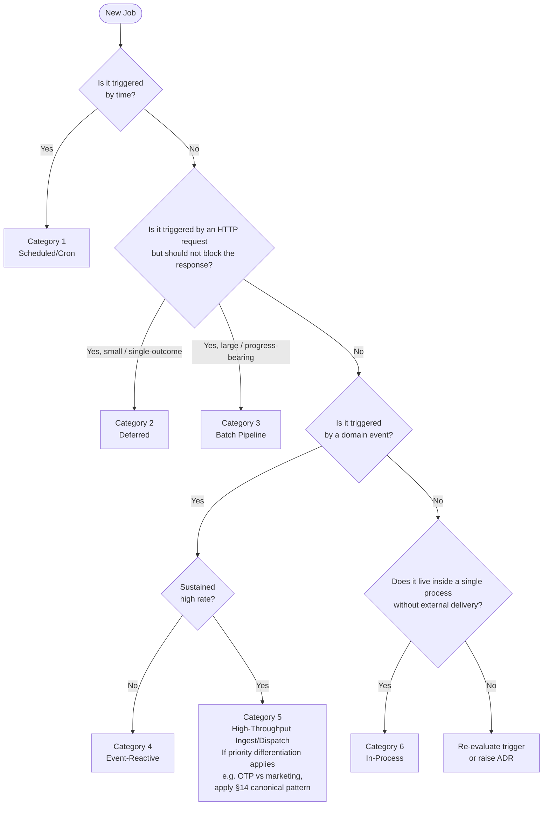

---

## 9. Job Lifecycle & Status Model

### 9.1 Canonical Lifecycle

Every job that crosses a process or network boundary follows the canonical lifecycle: `PENDING → RUNNING → SUCCEEDED / FAILED / DLQ`. A job enters `PENDING` when it is enqueued; it moves to `RUNNING` when a worker acquires the lease; it terminates in `SUCCEEDED` when the handler completes without error, in `FAILED` when the handler raises a retryable error and retry budget remains, or in `DLQ` when the retry budget is exhausted or the failure is non-retryable. The retry loop is `RUNNING → FAILED → RETRYING → RUNNING` and may cycle up to the declared maximum attempts before transitioning to `DLQ`. `DLQ` is a terminal state and cannot transition to any other state without an explicit admin replay action.

### 9.2 State Diagram

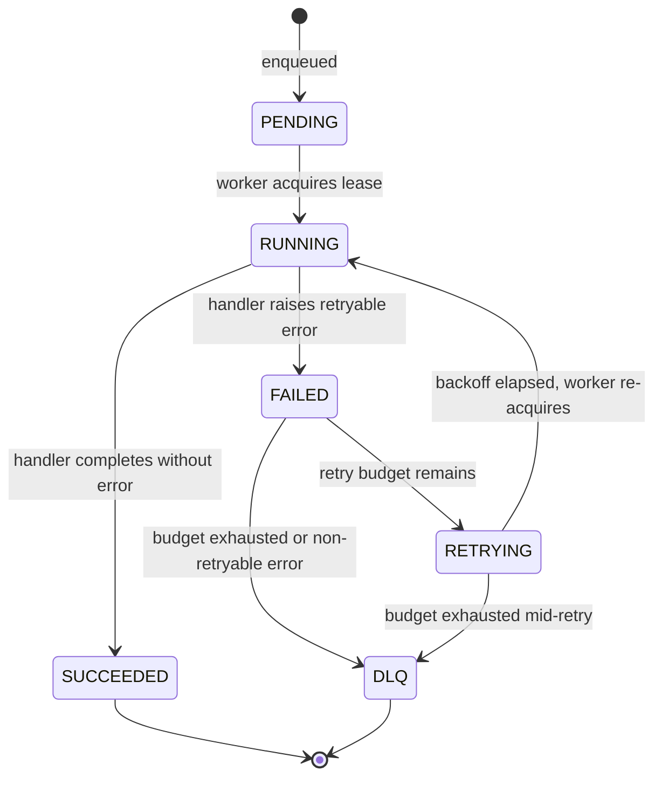

### 9.3 Allowed Transitions

| From | To | Trigger | Persisted in |
| --- | --- | --- | --- |
| *(new)* | PENDING | Producer enqueues the job | `background_job` table + broker |
| PENDING | RUNNING | Worker acquires lease from broker | `background_job.status` |
| RUNNING | SUCCEEDED | Handler returns without error | `background_job.status`, `finished_at` |
| RUNNING | FAILED | Handler raises retryable exception | `background_job.status`, `error`, `attempts` |
| FAILED | RETRYING | Retry budget not yet exhausted | `background_job.status` |
| RETRYING | RUNNING | Backoff elapsed; worker re-acquires | `background_job.status` |
| FAILED | DLQ | Budget exhausted or non-retryable flag | `background_job.status`; message moved to DLQ broker destination |
| RETRYING | DLQ | Budget exhausted during retry window | `background_job.status`; message moved to DLQ broker destination |

### 9.4 Per-Category Variations

- **Category 1 (Scheduled/Cron):** `PENDING` is transient — the scheduler fires the job immediately on schedule, so a Category 1 job is typically observed entering `RUNNING` without a visible `PENDING` dwell period.
- **Category 3 (Batch Pipeline):** Adds the `IN_PROGRESS` state between `RUNNING` and `SUCCEEDED`. Progress is tracked via a `%complete` field written to the `background_job_progress` table after each chunk. There is no *job-level* DLQ for Category 3 — the job itself is restartable from the last committed progress row, not dead-lettered as a whole. Individual skipped/failed *items* within a batch run are a separate concern: the per-technology implementation guides (e.g., §26.3's Spring Batch `SkipListener`) record those to `background_job_dlq` for operator review, at item granularity rather than job granularity.
- **Category 6 (In-Process):** States are in-memory only. No `background_job` table row is created. Retry is handled within the process using in-process retry logic. There is no DLQ; failures are logged and optionally reported to the error tracking system.

### 9.5 Admin Replay Contract

A message in DLQ state can be replayed by an authorized operator. Replay creates a new row in the `background_job` table with `replay_of` set to the original job's `job_id`, and the new job enters `PENDING` as a first-class job subject to the full lifecycle. Replay must be idempotent: submitting the same replay request twice must not produce two executions — callers must supply an idempotency key per §15. Every system governed by this standard must provide either a replay HTTP endpoint or a CLI command that invokes the replay path; the endpoint or command must be documented in the system's runbook per §33.

---

## 10. Job Status API Contract

### 10.1 Transport Independence

This standard defines the status contract — the fields, semantics, and cadence — not the transport. Systems may expose job status over REST or GraphQL. Both are valid; the choice is made at the system level and recorded in the system's TDD. If REST is used, URIs must be resource-oriented per the reference schema below. If GraphQL is used, the `Job` type and operations below are the canonical shape. In both cases, the status body fields and their semantics are identical.

### 10.2 REST Reference Schema

The following verbs and paths define the REST interface. Not all endpoints are required for all job categories; systems document which endpoints they support.

| Verb | Path | Response | Notes |
| --- | --- | --- | --- |
| `POST` | `/jobs` | `{ jobId, status: "PENDING" }` | Only for jobs enqueued via API. Not used for scheduler-triggered jobs (Category 1). |
| `GET` | `/jobs/{jobId}` | Full status body (§10.4) | Primary polling endpoint. |
| `GET` | `/jobs?filter=...` | Paginated list of status bodies | Optional; systems decide whether to expose. Cursor-based pagination (§10.6). |
| `POST` | `/jobs/{jobId}:cancel` | `{ jobId, status }` | Best-effort cancel. Implementation defines whether cancellation is supported for a given job type. |
| `POST` | `/jobs/{jobId}:replay` | `{ jobId, status: "PENDING" }` | Admin-only. DLQ replay for Category 4 and Category 5 jobs. Requires admin role (§34). |

### 10.3 GraphQL Equivalent

Systems exposing GraphQL use the following canonical shape. Field semantics are identical to the REST status body.

```graphql
type Job {
  id:            ID!
  type:          String!
  status:        JobStatus!
  progress:      JobProgress
  result:        JSON
  error:         JobError
  correlationId: ID
  createdAt:     DateTime!
  startedAt:     DateTime
  finishedAt:    DateTime
}

enum JobStatus { PENDING RUNNING SUCCEEDED FAILED RETRYING DLQ }

type JobProgress { processed: Int!, total: Int! }

type JobError { code: String!, message: String!, attempts: Int! }

type Query {
  job(id: ID!): Job
  jobs(filter: JobFilter, page: PageInput): JobConnection!
}

type Mutation {
  cancelJob(id: ID!): Job!
  replayJob(id: ID!, idempotencyKey: ID!): Job!
}

input PageInput { cursor: String, limit: Int }
```

### 10.4 Status Body Schema

The following JSON object is the canonical status body. It is returned verbatim from `GET /jobs/{jobId}` (REST) or the `job` query (GraphQL). Fields that do not apply to a job type are present with a `null` value, not omitted.

```json
{
  "jobId": "uuid",
  "type": "csv-import|welcome-email|...",
  "status": "PENDING|RUNNING|RETRYING|SUCCEEDED|FAILED|DLQ",
  "progress": { "processed": 0, "total": 0 },
  "result": {},
  "error": { "code": "...", "message": "...", "attempts": 3 },
  "correlationId": "uuid",
  "createdAt": "ISO-8601",
  "startedAt": "ISO-8601|null",
  "finishedAt": "ISO-8601|null"
}
```

`result` is opaque and job-defined; its schema is documented in the individual job's TDD. `error` is `null` when `status` is `PENDING`, `RUNNING`, or `SUCCEEDED`.

### 10.5 Poll Cadence Guidance

Clients polling `GET /jobs/{jobId}` should use exponential backoff: start at 500 ms, double on each poll, and cap at 30 s. Long-poll is not required and systems are not expected to support it. Clients must not poll at a fixed sub-second interval regardless of job state.

### 10.6 Pagination

The list endpoint (`GET /jobs?filter=...` or `jobs` query) uses cursor-based pagination. Offset-based pagination is not permitted. The page input is `{ cursor: <opaque string or null for first page>, limit: <integer, maximum 100> }`. The response includes a `nextCursor` field that is `null` when no further pages exist.

### 10.7 Security

All status endpoints require the caller to be authenticated. The replay endpoint (`POST /jobs/{jobId}:replay` or `replayJob` mutation) additionally requires the caller to hold the admin role as defined in §34. Systems must not expose job results or error detail to callers who do not have permission to view the originating job.

---

## 11. Job Dependencies & Chaining

This standard supports simple linear chains and DAG-style (fan-out/fan-in) dependencies. Complex workflow orchestration — sagas, compensation, long-lived workflow state, and human-in-the-loop wait states — is deferred to ORG-STANDARD-003.

### 11.1 Supported Patterns

**Linear chain:** Job B enqueues Job C on success. The dependency is expressed in code; no orchestration layer is required. The chain is easy to reason about and debug, but it is not recoverable mid-chain without replaying from the earliest failed step.

**Gated dependency:** Job B checks that all prerequisites are in a `SUCCEEDED` state by querying the `background_job_dependency` table before beginning execution. If prerequisites are not yet met, Job B exits early and reschedules itself. This pattern supports fan-in (multiple upstream jobs must complete before a downstream job proceeds).

### 11.2 `background_job_dependency` Schema

The dependency table is the source of truth for gated dependency checks. Full DDL is defined in §21.

| Column | Type | Description |
| --- | --- | --- |
| `job_id` | UUID | The dependent (downstream) job |
| `depends_on_job_id` | UUID | The prerequisite (upstream) job |
| `status` | ENUM | Mirrors the upstream job's terminal status at the time of check |
| `created_at` | TIMESTAMP | When the dependency relationship was recorded |

### 11.3 In-Scope vs Out-of-Scope

| Pattern | In-scope | Out-of-scope |
| --- | --- | --- |
| Linear chain (A→B→C) | ✅ | — |
| Simple DAG (fan-out/fan-in) | ✅ | — |
| Compensation / rollback | — | ORG-STANDARD-003 |
| Long-lived workflow state | — | ORG-STANDARD-003 |
| Human-in-the-loop wait states | — | ORG-STANDARD-003 |

### 11.4 Anti-Pattern

DO NOT build a bespoke workflow engine in your service. If you need multi-step orchestration with compensation, either wait for ORG-STANDARD-003 or file an ADR. The full anti-pattern index is in Appendix B.

### 11.5 Fan-Out Partial Failure Handling

A single job MAY fan out to N independent units of work (N downstream service calls, N rows in a batch) where some succeed and some fail. This is a simple DAG fan-out (§11.1, in scope) as long as the branches do not require compensation of the succeeded branches on partial failure — that case is orchestration and belongs to ORG-STANDARD-003 per §11.3.

- **Per-branch outcome MUST be recorded independently.** Persist a result (succeeded / failed / reason) per branch as an array of per-branch entries inside the parent job's `result` column (§21.1, `jsonb`) — not as a single pass/fail flag for the whole fan-out. A system with a high branch count or a need to query branch outcomes independently of the parent job MAY instead use a dedicated child-results table, in which case that table follows the same column conventions as `background_job_attempt` (§21.3) and must be documented in the system's TDD; this is an extension, not a substitute for recording the outcome somewhere durable.
- **Retry scope is per-branch, not per-job.** Re-running the parent job MUST re-read its own `result` column (or child-results table) before re-executing, and MUST NOT re-execute branches already recorded there as succeeded — only branches recorded as failed, or absent entirely, are retried. This requires the same idempotency discipline as any other handler (§15) applied at the branch level.
- **The parent job's terminal status reflects the aggregate.** `SUCCEEDED` only when every branch succeeded; a job with any permanently-failed branch after retry exhaustion is `FAILED` (or `DLQ` per its own retry contract, §7 Principle 2), with the per-branch detail preserved for operator triage — a job MUST NOT report `SUCCEEDED` while silently swallowing a branch failure.

### 11.6 Cross-Service Reconciliation Jobs

Where related data lives in separate services' own stores (§5.1 excludes cross-DB *transactions*, but does not exclude *eventual* cross-service referential integrity), a scheduled reconciliation job is the standard pattern for detecting and repairing drift — e.g., a reference that exists in Service A but whose corresponding row in Service B was never created because a Category-5 dispatch or webhook delivery (per ORG-STANDARD-004 §41) was lost or a consumer bug dropped an event before this standard's outbox pattern (§24) was in place.

- **Classification:** a reconciliation job is Category 1 (Scheduled/Cron) for routine drift-detection sweeps, or Category 3 (Batch Pipeline) when the detected drift set is large enough to need chunked/resumable processing (§9.4).
- **Detection, not blind repair.** The job compares the two services' records for the relationship being reconciled and classifies each mismatch (missing-downstream, missing-upstream, stale-downstream). Repair action MUST be idempotent (§15) and MUST be logged as a structured event distinguishable from normal job activity, since a repair is evidence that the primary consistency mechanism (outbox + consumer idempotency) had a gap.
- **Repair means re-driving creation, never deleting or undoing.** For a `missing-downstream` mismatch, repair re-publishes the missed event (or re-runs the missed dispatch) so the normal idempotent creation path runs again — it does not fabricate the downstream row directly, so the downstream service's own validation and side effects still execute. A `missing-upstream` mismatch (data exists downstream that the upstream side never produced) is NOT repaired by deleting or rolling back the downstream row — that is compensation, which §11.3 excludes and defers to ORG-STANDARD-003. Instead, a `missing-upstream` mismatch MUST only be flagged for manual/operator review; the reconciliation job detects it but does not act on it unilaterally. This boundary is what keeps reconciliation distinct from compensation: reconciliation only ever re-drives an already-defined, idempotent creation path forward, never reverses a side effect.
- **Alerting on rate, not on individual repairs.** An occasional reconciled mismatch is expected under at-least-once delivery; a rising rate of mismatches per run is a leading indicator of a producer or consumer defect and MUST be wired to the standard alerting pipeline (§27.3), not left to manual dashboard review.

---

## 12. Distributed Locks & Concurrency Control

### 12.1 Supported Lock Backends

**ShedLock (Spring/Quartz):** For distributed cron. Prevents duplicate fire across pod replicas. Preferred for Category 1 jobs in Java stacks. ShedLock stores the lock record in the same database as the application and releases it at the end of the scheduled method.

**PostgreSQL advisory locks (`pg_advisory_lock` / `pg_try_advisory_lock`):** For jobs coordinating around DB state. Auto-releases on connection close, providing a natural TTL tied to the worker's liveness. Preferred when the job's work is DB-bound and the database is shared among workers of the same service.

**Redis SET NX EX:** For cross-service coordination where a shared PostgreSQL instance is not available. Requires an explicit TTL and a lock-fencing token to prevent split-brain scenarios caused by lock expiry under GC pause or network partition.

### 12.2 Decision Table

| Scenario | Lock backend |
| --- | --- |
| Distributed cron single-fire | ShedLock (Java) / built-in (Hangfire has native distributed lock) |
| Serialize DB-bound work by key | PG advisory lock |
| Cross-service coordination | Redis SET NX EX with fencing token |
| Consumer-group single-delivery | None — the broker (SQS FIFO, Redis Streams consumer group) provides it |

### 12.3 Fencing Token Pattern

When using Redis SET NX EX for a critical section that spans multiple external calls, include a monotonic fencing token in every downstream call made while holding the lock. The downstream service rejects operations from stale tokens — that is, any token whose value is less than the highest token the downstream has already processed for that resource.

### 12.4 Timeout & Renewal

Locks must have a TTL at least as long as the job's worst-case execution duration. Long-running jobs must proactively renew or extend the lock before expiry; failure to renew allows another worker to acquire the lock while the first is still executing, producing concurrent access.

### 12.5 Anti-Patterns

- Holding a lock during external I/O (HTTP calls, S3 uploads) without a renewal mechanism.
- Locks that outlive the pod that acquired them, with no TTL to self-expire.
- Using `SELECT ... FOR UPDATE` as a distributed lock across service boundaries — this couples services to a shared schema and does not compose with broker-level delivery guarantees.

---

## 13. Priority & Fairness Framework

Priority is expressed by directing work to a **dedicated lane** — a separate queue and worker pool for each priority tier — not by using in-queue message priority. In-queue priority creates head-of-line blocking and prevents independent autoscaling of different tier workloads.

### 13.1 The Five Priority Tiers

| Tier | Purpose | Latency SLO | Autoscaling | Examples |
| --- | --- | --- | --- | --- |
| CRITICAL | Business-critical, revenue/security-touching | < 1s p99 | Always-on min replicas | OTP delivery, payment webhook |
| TRANSACTIONAL | Direct customer-visible outcome | < 5s p99 | KEDA, min 1 | Order confirmation email, receipt |
| STANDARD | Normal async work | < 30s p99 | KEDA, min 0 | Push notification, activity log |
| BULK | Non-urgent bulk operations | < 5min | KEDA capped max | Marketing SMS, newsletter |
| HOUSEKEEPING | Background maintenance | Hours-of-day | KEDA off-hours | Reports, index rebuilds |

### 13.2 Tier Selection Guidance

Every job MUST declare a tier at design time; tier is recorded in the job's TDD and in the message envelope (§17). If the correct tier is uncertain, default to STANDARD. Jobs classified as CRITICAL or TRANSACTIONAL require Security Lead review before deployment, because they carry a higher operational risk profile and must meet stricter availability and on-call escalation requirements.

### 13.3 Cross-Lane Rules

BULK and HOUSEKEEPING lanes must never share broker resources — queue names, Redis stream names, or consumer groups — with CRITICAL or TRANSACTIONAL lanes, because a saturated BULK lane must not delay CRITICAL message delivery. Each tier uses its own separately provisioned broker resources and a distinct worker pool with independent replica bounds.

### 13.4 Rate-Limit Propagation

Downstream provider rate limits are shared across all lanes; a fair-share token bucket allocates capacity per lane to prevent a BULK lane from exhausting rate headroom needed by CRITICAL jobs. The full rate-limit allocation pattern is defined in §14.

---

## 14. Canonical Pattern: High-Throughput Message Dispatch

This section defines the canonical implementation pattern for **Category 5** jobs — high-throughput ingest and dispatch workloads, particularly those that send messages to downstream communication providers (SMS gateway, email service, push provider). It applies whenever priority differentiation is required across message classes, for example OTP versus marketing SMS, or transactional email versus newsletter.

The pattern provides four integrated capabilities:

1. **Priority isolation via lanes** — each §13 tier receives its own queue and worker pool, preventing lower-priority volume from delaying critical messages (§14.1).
2. **Provider rate limiting via token bucket** — a shared token bucket enforces the provider's request-per-second budget without starving any lane (§14.2).
3. **Failure containment via circuit breaker** — a per-(lane, provider) breaker isolates failures so that a downed provider does not cascade across lanes or other providers (see §16).
4. **Deliverability tracking via `message_delivery_event` table** — every send and every provider callback is persisted so that delivery rate, bounce rate, and provider latency can be monitored per lane and per provider (§14.5).

### 14.1 Lane Architecture

Every message produced into the dispatch pipeline carries a `priority` field set to one of the five §13 tier names: CRITICAL, TRANSACTIONAL, STANDARD, BULK, or HOUSEKEEPING. A **router** component reads this field and dispatches the message to the queue that corresponds to that tier. Each lane has its own independently scaling worker pool; no worker pool is shared across lanes.

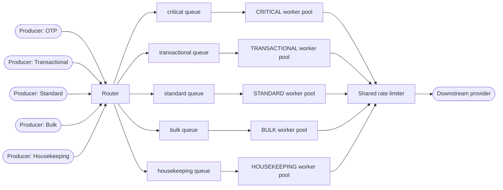

**Lane requirements:**

| Lane | Queue name pattern | Worker pool min | Worker pool max | Notes |
| --- | --- | --- | --- | --- |
| CRITICAL | `<system>-msg-critical` | 2 | KEDA-scaled | Always-on; SQS FIFO if strict order needed |
| TRANSACTIONAL | `<system>-msg-transactional` | 1 | KEDA-scaled | — |
| STANDARD | `<system>-msg-standard` | 0 | KEDA-scaled | — |
| BULK | `<system>-msg-bulk` | 0 | KEDA-scaled, capped | Prevents runaway spend |
| HOUSEKEEPING | `<system>-msg-housekeeping` | 0 | KEDA off-hours schedule | — |

**Cross-lane guarantees:** CRITICAL and TRANSACTIONAL lanes never share a worker pool with STANDARD, BULK, or HOUSEKEEPING lanes. A saturated BULK or HOUSEKEEPING worker pool cannot consume resources reserved for CRITICAL or TRANSACTIONAL work.

### 14.2 Provider Rate Limiting (Token Bucket)

Downstream providers — SMS gateways, email services, push providers — publish a fixed requests-per-second (QPS) budget. Exceeding this budget results in HTTP 429 responses and potential account suspension. The pattern enforces this budget using a **shared token bucket** that all lane worker pools draw from before dispatching a message to the provider.

**Token bucket algorithm:**

```text
bucket_capacity = provider_qps
refill_rate_per_sec = provider_qps

on send_request(lane, message):
    tokens = get_current_tokens(bucket)
    if tokens < 1:
        delay_message(message, next_refill_time)
        return
    atomic_decrement(bucket)
    call_provider(message)
```

**Fair-share allocation:** When the bucket is contested, each lane receives a reserved percentage of the provider's total QPS budget. Default allocations are:

| Lane | Reserved share |
| --- | --- |
| CRITICAL | 30% |
| TRANSACTIONAL | 30% |
| STANDARD | 25% |
| BULK | 10% |
| HOUSEKEEPING | 5% |

These percentages are configurable per system and must be documented in the system's TDD. The purpose is to guarantee that a sustained BULK or HOUSEKEEPING burst cannot exhaust the QPS budget needed by CRITICAL messages.

**Implementation:** The token bucket counter is stored in Redis. Each decrement is executed as a Lua script to provide atomic read-decrement-write semantics. The Redis key carries a TTL matching the refill window (typically 1 second) so that the bucket self-resets without an explicit refill step.

### 14.3 Failure Handling (Per-Provider)

**Circuit breaker per (lane, provider) pair.** Each combination of lane and downstream provider has its own circuit breaker. When a breaker opens — due to the failure rate over its rolling window exceeding the threshold defined in §16 — the worker parks new messages on the DLQ with reason code `provider_circuit_open`. Messages that arrive while the breaker is open are not attempted and do not consume retry budget. See §16 for breaker mechanics (failure threshold, half-open probe, reset window).

**Retry classification:**

| Provider response | Classification | Action |
| --- | --- | --- |
| 4xx (client error) | Non-retry-able | Move to DLQ immediately; do not consume retry budget |
| 5xx (server error) | Retry-able | Apply bounded exponential backoff per §7 principle 2 |
| Timeout / network error | Retry-able | Apply bounded exponential backoff per §7 principle 2 |

**Cross-lane failure isolation:** Because each (lane, provider) pair has its own breaker, a provider outage that trips the BULK lane breaker does not affect the CRITICAL lane breaker for the same provider. CRITICAL messages continue to be attempted while the BULK breaker is open, subject to the CRITICAL lane's independent failure threshold.

### 14.4 Deduplication and Idempotency

**Deduplication key format:** `<recipient_id>:<template_id>:<send_window_bucket>`

The `send_window_bucket` is the current timestamp rounded down to a fixed interval (for example, a 5-minute bucket: `floor(unix_seconds / 300) * 300`). This prevents accidental double-sends of the same content to the same recipient within a short window, including the case where a message is re-enqueued due to a producer retry or an upstream at-least-once event.

**Storage:** The deduplication record is written to the `message_dispatch_dedup` table (§21.2) with a TTL equal to the configured dedup window. The worker checks this record before calling the provider; if the record exists, the worker acknowledges the message and discards it without calling the provider. This is a distinct concern from §15.2's job-handler idempotency guard — this table dedupes by content/recipient/time-window, not by job identity.

**Interaction with retry:** A message that is retried after a transient failure reuses the same deduplication key. This ensures the provider is not called a second time for the same logical send even if the first call succeeded but the worker crashed before acknowledging the broker message.

### 14.5 Deliverability Tracking

**Persistence model:** Every dispatch attempt creates a row in the `message_dispatch` table. Every provider callback — delivered, bounced, opened, or failed — appends a row to the `message_delivery_event` table. Both tables are defined in §21.

**Aggregate metrics:** The following metrics are computed per lane and per provider and exposed to the standard observability stack (§27):

- **Delivery rate** — proportion of dispatched messages that receive a delivered callback within the provider's SLA window.
- **Bounce rate** — proportion of dispatched messages that result in a hard or soft bounce.
- **Provider latency** — time from dispatch attempt to provider acknowledgement (p50, p95, p99).

**SLO alerting rule:** If the delivery rate for the CRITICAL or TRANSACTIONAL lane falls below 95% over any 5-minute window, the observability system must fire a page-level alert to the on-call engineer. Lower-priority lanes use a warning-level alert at the same threshold.

### 14.6 Autoscaling Per Lane (KEDA)

Each lane's worker pool is scaled by a dedicated KEDA trigger. Full KEDA configuration — ScaledObject manifests, polling intervals, and cooldown periods — is defined in §25. The trigger sources and thresholds for each lane are:

| Lane | KEDA trigger source | Threshold |
| --- | --- | --- |
| CRITICAL | SQS ApproximateNumberOfMessages | scale on any backlog |
| TRANSACTIONAL | SQS ApproximateNumberOfMessages | scale on backlog > 10 |
| STANDARD | SQS ApproximateNumberOfMessages | scale on backlog > 50 |
| BULK | SQS ApproximateNumberOfMessages + max cap | scale on backlog > 500, cap 10 replicas |
| HOUSEKEEPING | CRON trigger (off-hours) | fixed schedule 02:00–06:00 |

The CRITICAL lane trigger scales on **any** backlog (threshold = 1) to ensure zero latency between message arrival and worker pickup. BULK lane autoscaling applies a maximum replica cap to prevent runaway spend during large sends. HOUSEKEEPING lane workers are only active during the off-hours window and are scaled to zero outside that window.

### 14.7 Consent Enforcement

Identified as a gap during a holistic cross-standard review: consent-gated dispatch (marketing SMS is this section's own canonical BULK-lane example) needs a consent check somewhere in the pipeline, but nothing previously specified where, or what happens on failure.

**Check point.** For any dispatch carrying consent-gated content (per the message's own classification, coordinated with whichever system owns consent/liability policy for that content — e.g., a CMS-class system per ORG-STANDARD-005's Integration Contract Registry), the **producer** MUST perform the consent check before enqueueing, not the worker. A message that fails its consent check MUST NOT be enqueued at all; it is rejected at the producer with a logged reason (`recipient_id`, `template_id`, `consent_status`, `checked_at`). A consent-gated message sitting in a queue, even briefly, is itself a compliance exposure this rule exists to avoid.

**Consent staleness for long-queued dispatch.** A consent check reflects the state at enqueue time. For lanes where queue delay can be material (BULK, per §14.6's autoscaling profile, and HOUSEKEEPING's off-hours batching), a recipient could withdraw consent after enqueue but before the message actually sends. Where the elapsed time between enqueue and dispatch attempt exceeds a stated threshold (default: 1 hour), the **worker** MUST re-check consent immediately before calling the provider — the producer's original check is not sufficient on its own for a dispatch that sat in queue long enough for consent state to plausibly have changed.

**Anti-patterns:**

- Checking consent only at enqueue time for a BULK-lane dispatch that may sit queued for hours, with no re-check before actual send.
- Rejecting a consent-gated message with no logged reason, making it impossible to later answer "why didn't this person receive X" during a compliance review.
- Performing the consent check in the worker instead of the producer, allowing a consent-failing message to occupy queue capacity before being discarded.

---

## 15. Idempotency Contracts

Every job handler MUST be idempotent. Because this standard adopts at-least-once delivery (§7 principle 1), any message may be delivered more than once — on worker crash, visibility timeout expiry, or broker redeliver. The idempotency contract defines how handlers detect and suppress duplicate executions so that multiple deliveries produce the same observable outcome as a single delivery.

### 15.1 Two Strategies

**Business-key idempotency.** Derive the idempotency key from a domain entity that is naturally unique for the logical unit of work. For example, `welcome-email:<user_id>` for a welcome email job, or `attendance-stat-update:<attendance_id>` for an attendance processing job. This is the preferred strategy when a natural business identifier exists, because the key is human-readable and directly debuggable in production.

**Job-key idempotency.** Derive the idempotency key from the job's input parameters when no single business identifier exists. For example, `monthly-attendance-report:<org_id>:<year>-<month>` for a scheduled monthly report. This strategy applies to Category 1 (Scheduled/Cron) and Category 3 (Batch Pipeline) jobs that operate on a parameter set rather than a single entity.

### 15.2 Guard Mechanism

The idempotency key is stored directly on `background_job.job_key` (§21.1), which carries a `UNIQUE` constraint. There is no separate presence-only guard table — a presence check alone cannot distinguish "already succeeded, skip" from "previously failed, safe to retry," which would silently drop legitimate retries. `background_job.status` is what makes that distinction, so the guard checks status, not mere existence.

The guard works as follows:

1. **Atomic insert.** The first worker to accept a message performs an atomic INSERT of a new `background_job` row with the derived `job_key`. In PostgreSQL:

   ```text
   INSERT INTO background_job (id, job_key, status, ...)
   VALUES (:id, :job_key, 'PENDING', ...)
   ON CONFLICT (job_key) DO NOTHING
   RETURNING id
   ```

   If the `RETURNING` clause returns a row, this is the first-ever delivery for this key; the worker proceeds. A read-then-write pattern (SELECT, then INSERT if not found) is prohibited because it introduces a race condition under concurrent delivery.

2. **Status check on conflict.** If no row is returned, a `background_job` row for this `job_key` already exists. Re-read its `status`:
   - `SUCCEEDED` — the work is done. Acknowledge the broker message without re-executing the handler.
   - `FAILED` or `DLQ` (terminal, unsuccessful) — this is a legitimate retry per §13's retry policy, not a duplicate delivery. Reset the existing row to `PENDING`, increment `attempts`, and proceed with the handler.
   - `PENDING` or `RUNNING` — another worker is currently processing (or about to process) this key. Acknowledge and skip; do not process concurrently. If this state persists beyond the job's configured deadline (§21.1 `deadline`), that is a stuck-job condition handled by the standard's deadline/timeout monitoring, not by this guard.

This is the same mechanism the worked examples in §35.5 and §39.2 already use — this section makes it the single, canonical guard rather than a second, conflicting one.

### 15.3 Key Derivation Rules

| Rule | Requirement |
| --- | --- |
| Deterministic | Same inputs MUST always produce the same key. Two workers processing the same logical message must derive identical keys. |
| No random components | MUST NOT include random UUIDs, nonces, or `now()` timestamps. These would produce unique keys on every delivery, defeating deduplication. |
| No mutable state | MUST NOT include fields that can change between deliveries of the same message (e.g., a processing timestamp written into the envelope by an intermediate hop). |
| Human-readable | SHOULD be readable without decoding. A key like `welcome-email:u-4821` is debuggable; a hashed byte string is not. |

### 15.4 Retention

Since the v2.0 MAJOR change, the idempotency guard is `background_job.job_key` itself (§15.2) — there is no separate idempotency table. Idempotency-guard retention therefore follows §21's Retention Policy for `background_job` directly: **90 days minimum** for `SUCCEEDED` rows, **1 year minimum** for `FAILED`/`DLQ` rows (both comfortably longer than any realistic DLQ-replay delay, so a replayed message is still correctly deduplicated against its original job row). This section does not define an independent retention window — doing so would risk drifting out of sync with §21's authoritative minimums, exactly as the pre-v2.0 version of this section once did.

The distinct `message_dispatch_dedup` table (§21.2, dispatch-pipeline content deduplication — a different concern from job-handler idempotency, see §14.4) retains its own **30 days beyond the system's maximum retry window**, per §21's Retention Policy.

### 15.5 Testing Requirement

Every job's test suite MUST include a "replay 3 times, verify single side effect" test: enqueue the same logical message three times with the same idempotency key and assert that the downstream effect (database write, outbound call, notification sent) occurs exactly once. Testing standards are defined in §31.

---

## 16. Circuit Breaker & Backpressure

Every external dependency accessed from within a job handler — downstream REST API, third-party provider, another BAPS system, or message broker — MUST be guarded by a circuit breaker, using the profile matching that dependency's nature (§16.2). Circuit breakers isolate failure: when a dependency degrades, the breaker opens and workers stop attempting calls that will fail, protecting both the dependency and the worker thread pool from exhaustion. Database and cache connections are governed by ORG-STANDARD-004 §48's connection pooling instead — a connection pool's exhaustion/acquire-timeout behavior serves the equivalent purpose for that class of dependency, and is not duplicated here.

### 16.1 Circuit Breaker States

The breaker transitions through four states:

**CLOSED (normal operation).** All calls pass through to the dependency. The breaker records the outcome of each call within a rolling observation window.

**OPEN (failure threshold breached).** Calls to the dependency are rejected immediately without attempting the network call. Workers receive a fast-fail signal and apply the backpressure behavior described in §16.3. The breaker remains open for the configured open duration before transitioning to HALF_OPEN.

**HALF_OPEN (probing recovery).** The breaker allows a limited probe set of calls through to test whether the dependency has recovered. Calls outside the probe set continue to fail-fast.

**CLOSED (recovered).** If the probe set achieves the required success rate, the breaker closes and resumes normal operation. If the probe set does not achieve the required success rate, the breaker returns to OPEN and the open timer restarts.

### 16.2 Standard Thresholds — Two Profiles

A single parameter set does not fit every dependency: an external third-party provider's capacity and failure behavior under load is genuinely less predictable than another BAPS system's, and treating them identically either over-trips on internal calls or under-reacts to real external degradation. This standard defines two named profiles; every circuit breaker MUST declare which profile it uses. Systems MAY tune either profile's values with documented justification in their TDD, but MUST NOT silently blend the two.

**Profile: External Third-Party Provider** — SMS/email/push gateways, payment processors, and other non-BAPS-owned dependencies whose capacity and failure modes are outside BAPS's control:

| Parameter | Default | Notes |
| --- | --- | --- |
| Observation window | 30-second rolling | Based on call outcomes within the window |
| Minimum sample size | 10 calls | Breaker will not open with fewer than 10 samples, even if all fail |
| Failure rate threshold | 50% | If ≥50% of calls in the window fail, the breaker opens |
| Open duration | 30 seconds | Breaker stays OPEN for 30s before transitioning to HALF_OPEN |
| Probe set size (HALF_OPEN) | 5 requests | 5 calls are allowed through to test recovery |
| Recovery success threshold | ≥80% of probe set | If ≥4 of 5 probes succeed, the breaker closes |

**Profile: Internal Service-to-Service** — calls to another BAPS-owned system (e.g., MDS, ASM, WFS). An internal dependency is expected to be materially more reliable than an external one, and a real degradation is more likely to indicate an actionable problem worth reacting to faster, not routine third-party flakiness to ride out:

| Parameter | Default | Notes |
| --- | --- | --- |
| Observation window | 20-second rolling | Shorter than the external profile's, matching internal calls' typically higher volume and faster feedback loop |
| Minimum sample size | 20 calls | Higher than the external profile's, since internal call volume is typically higher and a larger sample avoids false trips on a brief blip |
| Failure rate threshold | 30% | Tighter than the external profile's 50% — an internal dependency failing this often is a real signal, not expected background noise |
| Open duration | 15 seconds | Shorter than the external profile's 30s — an internal BAPS-owned system is expected to recover faster, and probing sooner reduces unnecessary fail-fast duration |
| Probe set size (HALF_OPEN) | 5 requests | Unchanged from the external profile |
| Recovery success threshold | ≥80% of probe set | Unchanged from the external profile |

### 16.3 Backpressure Signals

When a breaker opens, the worker MUST reduce its consumption rate from the broker. Continuing to poll at the normal rate while calls fail-fast wastes worker threads and produces a storm of visibility-timeout re-deliveries. Workers apply the following backpressure measures:

- **Extend polling interval** — increase the time between broker poll calls (e.g., from 1s to 10s) for the affected lane.
- **Reduce prefetch count** — reduce the number of messages fetched in a single poll batch so fewer messages are in-flight while the breaker is open.

These measures are in addition to any broker-level throttle and apply immediately upon breaker transition to OPEN.

### 16.4 Breaker-Open Message Behavior

When a worker receives a message and the relevant breaker is OPEN, the message is **held with an in-broker delay** rather than immediately dead-lettered. For SQS, the worker calls `ChangeMessageVisibility` with a delay extension (minimum 60 seconds) to return the message to the queue without consuming retry budget. This allows the message to be re-attempted after the breaker transitions to HALF_OPEN or CLOSED.

Exception: if the failure that opened the breaker is classified as **non-retry-able** (for example, an authentication rejection from a downstream API indicating a configuration error rather than a transient outage), the message is moved to the DLQ immediately with reason code `circuit_open_non_retryable`. The retry classification rules are defined in §14.3.

### 16.5 Library Recommendations

| Platform | Recommended library | Notes |
| --- | --- | --- |
| .NET | Polly | `CircuitBreakerPolicy` or `AdvancedCircuitBreaker`; configure via `PolicyRegistry` for shared policies across handler instances |
| Java (Spring Boot) | Resilience4j | `CircuitBreaker` module with `CircuitBreakerConfig`; integrate with Spring Boot actuator for health exposure |
| Java (Spring Retry) | `@CircuitBreaker` annotation | Suitable for simpler use cases; Resilience4j preferred for per-(lane, provider) granularity |

Per-technology implementation guidance, including configuration examples, is in §26.

---

## 17. Message Envelope & Payload Contract

Every message produced into a BAPS broker MUST be wrapped in the standard envelope defined in this section. The envelope is the wire contract between producers and consumers; workers must be able to parse and validate the envelope before inspecting the payload.

### 17.1 Envelope Field Table

| Field | Type | Required | Purpose |
| --- | --- | --- | --- |
| `schemaVersion` | integer | ✅ | Envelope schema version; start at 1 |
| `messageId` | UUID | ✅ | Unique per message; distinct from `jobId` |
| `producer` | string | ✅ | System/service that enqueued (e.g., `sampark-api`) |
| `type` | string | ✅ | Message type identifier (e.g., `welcome-email`) |
| `enqueuedAt` | ISO-8601 | ✅ | UTC timestamp of enqueue |
| `deadline` | ISO-8601 | optional | Business-level absolute deadline |
| `traceparent` | W3C string | ✅ | Trace context (§18) |
| `correlationId` | UUID | ✅ | End-to-end correlation (§18) |
| `priority` | enum | ✅ for Category 5 | One of the 5 tiers (§13) |
| `payload` | object | ✅ (unless `payloadRef`) | Message body |
| `payloadRef` | object | ✅ (unless `payload`) | Claim-check reference (§20) |
| `idempotencyKey` | string | optional | If producer computes it (§15) |
| `replayOf` | UUID | optional | Set when replayed from DLQ (§9) |

`payload` and `payloadRef` are mutually exclusive: exactly one must be present. `payloadRef` is used when the payload exceeds the size limit (§17.3) and the claim-check pattern (§20) is applied.

### 17.2 JSON Example

The following is a fully-populated envelope for a `welcome-email` message:

```json
{
  "schemaVersion": 1,
  "messageId": "a1b2c3d4-0001-0002-0003-000000000001",
  "producer": "sampark-api",
  "type": "welcome-email",
  "enqueuedAt": "2026-07-15T08:30:00Z",
  "deadline": "2026-07-15T09:30:00Z",
  "traceparent": "00-4bf92f3577b34da6a3ce929d0e0e4736-00f067aa0ba902b7-01",
  "correlationId": "d4e5f6a7-0011-0012-0013-000000000099",
  "priority": "TRANSACTIONAL",
  "payload": { "userId": "u-4821", "email": "member@example.org", "locale": "en" },
  "idempotencyKey": "welcome-email:u-4821"
}
```

Optional fields `replayOf`, `payloadRef`, and producer-omitted `idempotencyKey` and `deadline` are absent here because they are not applicable: `payloadRef` is mutually exclusive with `payload` (see §20), `replayOf` is only present on DLQ replay (see §9), and the remaining optional fields are omitted when the producer does not supply them.

### 17.3 Size Limit and Serialization

**Size limit:** The total serialized envelope MUST NOT exceed **256 KB**. This matches the maximum SQS message size and applies across all supported broker types for consistency. If the payload would cause the envelope to exceed 256 KB, the producer MUST apply the claim-check pattern (§20): store the payload in object storage, set `payloadRef` to a reference object containing the storage location and content hash, and omit `payload` from the envelope.

**Serialization:** Envelopes are serialized as **JSON only**. Binary serialization formats (Protobuf, Avro, MessagePack) are not used for the envelope layer. Security constraints on deserialization are defined in §19.

### 17.4 Schema Evolution

The `schemaVersion` field governs envelope schema evolution. The following rules apply:

- **Producers may add fields** to the envelope in a minor version increment without requiring consumer changes. Consumers MUST ignore unknown fields (do not fail on unrecognized keys).
- **Breaking changes** — removing required fields, renaming fields, or changing field types — require a `schemaVersion` increment and a coordinated migration plan. Breaking changes go through the change control process defined in §41.
- Producers MUST NOT remove fields that consumers depend on without incrementing `schemaVersion` and providing a migration window.

### 17.5 Out-of-Order Delivery

Brokers do not guarantee delivery order except where an ordered mode is explicitly selected — SQS FIFO for strict per-key ordering (§23's constraint-driven override table), or a single Redis Stream's inherent append order (§26.6). Even with an ordered broker, a redelivered retry can arrive after a later message that was already processed once the earlier one fails and re-queues. Every consumer MUST therefore be able to tolerate messages arriving out of their logical order:

- **Version-stamp the payload.** Every message that represents a state update to an entity MUST carry a monotonic version marker for that entity — a sequence number, or the source system's own `updated_at` timestamp. This is separate from `messageId`/`correlationId` (§17.1), which identify the message, not the entity's logical version.
- **Consumers MUST compare-and-discard, not blind-apply.** Before applying an update, the handler compares the incoming version marker against the last-applied version already persisted for that entity. An incoming message with a version marker older than or equal to the last-applied one is a no-op: log it at `INFO`, do not error, do not retry, do not route to DLQ — this is expected behavior under at-least-once delivery (§7 Principle 1), not a failure.
- **This does not require strict ordering from the broker.** The pattern is designed so correctness depends on the consumer's compare-and-discard logic, not on delivery order — which is why Standard (unordered) queues remain usable for Category 4/5 jobs that would otherwise require FIFO solely to avoid this problem (§23's FIFO-vs-Standard guidance already lists ordering as one deciding factor; this section is what makes Standard queues safe when ordering is *not* selected).

---

## 18. Correlation ID & Distributed Tracing

Every job execution MUST be traceable end-to-end: from the HTTP request (or scheduled trigger) that originated the work, through the producer that enqueued the message, through the broker, into the worker, and through any downstream calls the worker makes. This section defines how trace context is carried and restored at each hop.

### 18.1 Mandatory Envelope Fields

Every message envelope (§17) MUST carry both of the following fields:

- **`traceparent`** — the W3C Trace Context header value (format: `00-<trace-id>-<parent-id>-<flags>`). Carries the distributed trace identifier across process and network boundaries.
- **`correlationId`** — an application-level UUID that identifies the end-to-end business operation. `correlationId` is distinct from the trace ID: it is human-readable in logs and persists across retries, replays, and downstream re-enqueues.

### 18.2 Propagation Threading

Trace context flows through each hop as follows:

1. **HTTP request arrives at the producer service.** The producer extracts the `traceparent` header from the inbound HTTP request. If no `traceparent` is present (see §18.5 for the fallback), the producer generates one.
2. **Producer enqueues the message.** The producer writes the extracted (or generated) `traceparent` value and a `correlationId` into the message envelope before calling the broker.
3. **Worker receives the message.** The worker reads `traceparent` and `correlationId` from the envelope and restores them into the active trace context before executing any handler logic. All spans created during handler execution are children of the restored trace context.
4. **Worker makes downstream calls.** Any HTTP calls, database queries, or downstream enqueues made from within the handler propagate the active trace context using the standard instrumentation for the platform (§18.3 and §18.4).

### 18.3 Java Integration

Java services use **OpenTelemetry auto-instrumentation** where available:

- For `@SqsListener` consumers, the auto-instrumentation agent extracts `traceparent` from SQS message attributes and creates a child span automatically.

If auto-instrumentation does not cover a specific integration point, the handler MUST perform manual propagation: extract the `traceparent` string from the envelope, create an `OtelPropagator` context from it, and make that context the current context before executing handler logic.

### 18.4 .NET Integration

.NET services use the **`System.Diagnostics.Activity` API** (the built-in W3C Trace Context implementation):

- Hangfire jobs implement `IJobFilter`. The filter's `OnPerforming` method extracts `traceparent` from the job parameters, creates a new `Activity` with `SetParentId(traceparent)`, and starts it. The filter's `OnPerformed` method stops the activity.
- For SQS consumers using the AWS SDK, the handler manually reads `traceparent` from the SQS message attribute, sets it as the parent of a new `Activity`, and starts the activity before invoking the job logic.

### 18.5 Missing `traceparent` Fallback

When the originator of a job is not an HTTP request — for example, a scheduled cron trigger, a batch pipeline step, or a manual admin action — there may be no inbound `traceparent` to extract. In this case:

1. The producer generates a fresh `traceparent` (a new root span with a new trace ID).
2. The producer logs a structured field `traceparent_source=synthetic` alongside the generated `traceparent` value to signal that this trace does not descend from an inbound HTTP request.
3. Correlation ID generation follows the same rule: only the originating producer generates a new `correlationId`. Any downstream re-enqueue (retry, replay, chained job) carries forward the same `correlationId` without generating a new one.

### 18.6 Log Correlation

Every log line emitted from within a job handler MUST include both `correlationId` and `traceId` (extracted from `traceparent`) in the structured log context. In Java stacks, these fields are placed in the MDC (Mapped Diagnostic Context). In .NET stacks, they are added to the structured log scope.

This requirement is enforced by the standard log envelope defined in §27. A job that emits log lines without these fields is non-compliant regardless of its functional behavior.

---

## 19. Serialization Security

Deserializing attacker-controlled data with unsafe deserializers is one of the most prevalent remote code execution (RCE) vectors in distributed systems. Because message brokers are shared infrastructure, a single malformed or malicious message can exploit a vulnerable deserializer and compromise every worker that processes it. This section names specific banned patterns that MUST be rejected at code review and defines the safe alternatives that all workers MUST use.

### 19.1 Banned Patterns

The following deserializer configurations are banned across all BAPS systems. Code reviewers MUST block any code that introduces these patterns. The ban applies to all message-handling paths including job handlers, consumer callbacks, and any helper that processes broker-delivered data.

| Language / Library | Banned | Reason |
| --- | --- | --- |
| .NET | `BinaryFormatter` | Known RCE vector; deprecated in .NET 5+ |
| .NET Newtonsoft.Json | `TypeNameHandling.All` / `.Auto` / `.Objects` | Gadget-chain attacks |
| .NET System.Text.Json | Custom `JsonConverter` with type discrimination via string | Only allowed with explicit allow-list |
| Java | `ObjectInputStream` on untrusted input | RCE via gadget chains |
| Java Jackson | `enableDefaultTyping()` unrestricted | Gadget-chain attacks |
| Python / general | `yaml.load` (use `yaml.safe_load`) | Arbitrary object construction |
| Python | `pickle` on untrusted input | RCE |
| JavaScript | `eval`, `Function()` on message content | Trivial RCE |

### 19.2 Required Safe Patterns

All workers MUST use the following safe alternatives:

- JSON with strict schema validation (JSON Schema or code-first with typed models).
- Type discrimination via **allow-listed** enum, not open-ended class names or arbitrary type strings.
- Message body validated on receive before dispatch to business logic; validation failure does not invoke any handler logic.

### 19.3 Envelope Validation

Every worker MUST validate all envelope fields on receive before processing the message body. Validation checks at minimum: presence of all required fields (see §17), correct types, and values within expected ranges. A message that fails envelope validation MUST NOT be retried through the normal retry path. It is immediately routed to the DLQ with reason code `invalid_envelope`. The DLQ entry MUST include the raw message bytes and the validation error detail to support post-incident forensic analysis.

### 19.4 Compliance

Any deviation from the banned-pattern list or the required safe patterns requires Security Lead sign-off and a filed ADR naming this section.

---

## 20. Payload Size Limits & Claim-Check

### 20.1 Broker Size Limits

Every message — envelope plus payload — MUST fit within the broker's maximum message size. Platform limits are:

- **SQS:** 256 KB per message (hard limit enforced by the broker).
- **Redis Streams:** practical per-entry limit of approximately 1 MB; entries above this size degrade stream performance and MUST be avoided.

### 20.2 Claim-Check Trigger

If a message payload exceeds **200 KB**, the producer MUST use the claim-check pattern rather than embedding the payload directly in the message. The 200 KB threshold provides headroom below the 256 KB SQS hard limit and accounts for envelope overhead and base64 expansion.

Under the claim-check pattern:

1. The producer serializes and uploads the payload to object storage (S3) before enqueuing the message.
2. The producer replaces the inline payload in the envelope with a `payloadRef` object pointing to the stored object.
3. The worker reads `payloadRef` on receive, fetches the payload from object storage, and processes it as if it had arrived inline.

### 20.3 `payloadRef` Schema

The `payloadRef` field in the envelope MUST conform to the following structure:

```json
{
  "payloadRef": {
    "type": "s3",
    "bucket": "baps-jobs-<system>",
    "key": "payloads/<yyyy-mm>/<messageId>.json",
    "etag": "abc123",
    "sizeBytes": 1048576
  }
}
```

Field definitions:

- `type`: storage backend identifier. Current valid value: `s3`.
- `bucket`: the S3 bucket name, following the naming convention `baps-jobs-<system>` where `<system>` is the owning system identifier. The bucket naming pattern `baps-jobs-<system>` is a suggested convention; systems may use their existing bucket naming rules provided the security controls in §20.6 are met.
- `key`: object key path. The path MUST use the prefix `payloads/<yyyy-mm>/` where `<yyyy-mm>` is the UTC calendar month of upload, followed by the `messageId` as the file name.
- `etag`: the ETag returned by S3 on upload. Workers MUST verify the ETag on fetch to detect storage corruption.
- `sizeBytes`: the size of the uploaded payload in bytes, recorded at upload time.

### 20.4 Object Lifecycle

Payload objects MUST be covered by an S3 lifecycle policy that automatically expires them. The TTL of the lifecycle rule MUST equal the retention window of the associated DLQ — per §21's mandatory retention minimum, that is **1 year** for `background_job_dlq` rows (not 14 days; an earlier version of this section stated 14 days as if it were the default, which understated §21's actual minimum and could leave a DLQ row valid and replayable for up to a year after its claim-check payload had already been purged). Systems that configure a DLQ retention longer than §21's minimum MUST extend the lifecycle TTL to match that longer value, ensuring a DLQ message can always retrieve its payload for as long as the DLQ row itself remains valid.

### 20.5 Compression

Payloads exceeding **1 MB** SHOULD be gzipped before upload to S3. When compression is applied, the `Content-Encoding: gzip` metadata MUST be recorded on the S3 object. Workers MUST inspect the object metadata and decompress accordingly before deserializing.

### 20.6 Security

Payload objects MUST be protected as follows:

- **Encryption at rest:** SSE-KMS using a system-owned KMS key (not the default AWS-managed key). The key policy MUST restrict usage to the owning system's IAM roles.
- **Access isolation:** the bucket policy MUST deny all cross-account access. Workers in other BAPS systems that legitimately need to trigger cross-system jobs MUST do so through the owning system's job API, not by reading the payload bucket directly.

### 20.7 Failure Modes

Two failure modes arise specifically from the claim-check pattern:

**(a) Payload upload fails before enqueue.** If the S3 upload fails, the producer MUST abort the entire operation and return an error to the caller. The message MUST NOT be enqueued with a `payloadRef` pointing to an object that was not successfully written.

**(b) Payload fetch fails on worker.** If the worker cannot retrieve the payload from S3, the failure is treated as a transient error and retried per the retry policy defined in §7. If the payload remains unretrievable after exhausting retries, the message is routed to the DLQ with reason code `payload_missing`. DLQ entries with this reason code require manual operator intervention to locate or reconstruct the payload before replay.

---

## 21. Data Model

Every BAPS system implementing background processing MUST provide the eight tables defined in this section. These tables constitute the normative persistence schema for background-job execution. Table names MUST match those specified (a system-specific schema prefix such as `sampark.background_job` is permitted, but the table name and column set MUST remain identical). Deviations require an ADR.

Full DBML source at `org_standards/dbml/ORG-STANDARD-002-data-model.dbml`.

### 21.1 `background_job`

The canonical job record. Every job execution begins and ends here.

| Column | Type | Notes |
| --- | --- | --- |
| `id` | uuid | Primary key |
| `job_type` | varchar(128) | Producer-defined type (e.g., `welcome-email`) |
| `job_key` | varchar(256) | Idempotency key; `UNIQUE` — at-most-one row per key, with `status` (below) governing retry-safety (§15.2) |
| `status` | varchar(32) | `PENDING` \| `RUNNING` \| `SUCCEEDED` \| `FAILED` \| `DLQ` |
| `priority` | varchar(32) | `CRITICAL` \| `TRANSACTIONAL` \| `STANDARD` \| `BULK` \| `HOUSEKEEPING` |
| `correlation_id` | uuid | Propagated from originating request |
| `trace_id` | varchar(64) | OpenTelemetry trace identifier |
| `producer` | varchar(128) | System or service that created the job |
| `created_at` | timestamptz | Row creation time (default: `now()`) |
| `started_at` | timestamptz | Time worker first claimed the job |
| `finished_at` | timestamptz | Time job reached terminal state |
| `deadline` | timestamptz | Hard deadline; job fails if not finished by this time |
| `attempts` | int | Count of execution attempts (default: 0) |
| `max_attempts` | int | Maximum allowed attempts before DLQ (default: 5) |
| `replay_of` | uuid | Populated when this job was replayed from DLQ |
| `result` | jsonb | Outcome payload written on success |

Indexes: `(status, priority)`, `correlation_id`, `(job_type, created_at)`, `UNIQUE (job_key)` (enforces §15.2's guard).

### 21.2 `message_dispatch_dedup`

A distinct, narrower concern from §15.2's job-handler idempotency above: this table backs §14.4's content-based dedup for the high-throughput dispatch pipeline (preventing an accidental double-send of the same content to the same recipient within a short time-bucket), keyed by `<recipient_id>:<template_id>:<send_window_bucket>` rather than by job identity. It has no relationship to a specific job's status — a dispatch can legitimately be retried by a new job while still correctly deduplicating against a recent send of the same content. (This table was previously named `background_job_idempotency` and shared with §15.2's guard; the two concerns are now separated — §15.2 uses `background_job.job_key`/`status` directly, per above.)

| Column | Type | Notes |
| --- | --- | --- |
| `key` | varchar(256) | Primary key — the `<recipient_id>:<template_id>:<send_window_bucket>` dedup key |
| `job_id` | uuid | References `background_job.id` of the dispatch attempt that first claimed this key |
| `first_seen_at` | timestamptz | Time the key was first recorded (default: `now()`) |
| `expires_at` | timestamptz | Garbage-collection timestamp; row may be deleted after this time |

Index: `expires_at` (supports GC sweep).

### 21.3 `background_job_attempt`

Per-attempt audit log. One row is inserted for every execution attempt, regardless of outcome.

| Column | Type | Notes |
| --- | --- | --- |
| `id` | uuid | Primary key |
| `job_id` | uuid | Foreign key to `background_job.id` |
| `attempt_number` | int | 1-based counter; unique per job |
| `started_at` | timestamptz | Time the worker began processing |
| `finished_at` | timestamptz | Time the attempt concluded |
| `outcome` | varchar(32) | `success` \| `failure` \| `timeout` |
| `error_code` | varchar(64) | Application or infrastructure error code |
| `error_message` | text | Human-readable error detail |
| `worker_id` | varchar(128) | Pod or process identifier |

Unique index: `(job_id, attempt_number)`.

### 21.4 `background_job_dlq`

DLQ persistence. One row per job that has been moved to the dead-letter state. Records the reason code, original envelope, and replay audit fields.

| Column | Type | Notes |
| --- | --- | --- |
| `id` | uuid | Primary key |
| `job_id` | uuid | Foreign key to `background_job.id` |
| `reason_code` | varchar(64) | See reason code enum below |
| `failure_details` | jsonb | Full error context at time of DLQ routing |
| `original_envelope` | jsonb | Copy of the job envelope as received |
| `dlq_at` | timestamptz | Time the row was inserted (default: `now()`) |
| `replayed_at` | timestamptz | Set when an operator replays this DLQ entry |
| `replayed_by` | varchar(128) | Operator identity that triggered replay |

Indexes: `reason_code`, `dlq_at`.

**Reason code enum:**

| Reason Code | Meaning | Retry-able via replay? |
| --- | --- | --- |
| `retry_exhausted` | Exceeded max_attempts | ✅ (with judgment) |
| `non_retryable` | 4xx-class business error | ⚠️ Only after fixing input |
| `circuit_open` | Downstream circuit was open at time of DLQ | ✅ |
| `invalid_envelope` | Envelope failed schema validation | ⚠️ Only after fixing envelope |
| `payload_missing` | Claim-check payload not fetchable | ⚠️ Only if payload restored |
| `provider_permanent_error` | Provider returned permanent failure | ⚠️ Depends on cause |

### 21.5 `background_job_progress`

Category 3 batch progress tracking and restart checkpoint. One row per job; updated in place as the job advances.

| Column | Type | Notes |
| --- | --- | --- |
| `job_id` | uuid | Primary key; foreign key to `background_job.id` |
| `processed` | int | Count of items processed so far (default: 0) |
| `total` | int | Total item count (default: 0; set on job start) |
| `last_updated_at` | timestamptz | Time of most recent update (default: `now()`) |
| `checkpoint` | jsonb | Job-defined restart checkpoint; enables resumption for Category 3 batch pipelines |

### 21.6 `background_job_dependency`

DAG edges. Each row expresses that `job_id` MUST NOT start until `depends_on_job_id` has reached `SUCCEEDED`.

| Column | Type | Notes |
| --- | --- | --- |
| `job_id` | uuid | Foreign key to `background_job.id` — the dependent job |
| `depends_on_job_id` | uuid | Foreign key to `background_job.id` — the prerequisite job |
| `created_at` | timestamptz | Row creation time (default: `now()`) |

Primary key: `(job_id, depends_on_job_id)`. Index on `depends_on_job_id` supports fan-out queries (find all jobs blocked by a given job).

### 21.7 `message_dispatch`

Category 5 outbound dispatch record. One row per message sent to an external provider.

| Column | Type | Notes |
| --- | --- | --- |
| `id` | uuid | Primary key |
| `job_id` | uuid | Foreign key to `background_job.id`; nullable for standalone dispatches |
| `lane` | varchar(32) | Dispatch lane (e.g., `email`, `sms`, `push`) |
| `provider` | varchar(64) | Provider identifier (e.g., `sendgrid`, `twilio`) |
| `recipient_ref` | varchar(256) | Opaque recipient identifier — MUST be hashed if it contains PII |
| `template_id` | varchar(128) | Provider template identifier |
| `sent_at` | timestamptz | Time the message was handed off to the provider |
| `provider_message_id` | varchar(256) | Provider-assigned message ID returned on send |
| `final_status` | varchar(32) | `delivered` \| `bounced` \| `failed` \| `pending` |
| `created_at` | timestamptz | Row creation time (default: `now()`) |

Indexes: `(lane, provider, created_at)`, `provider_message_id`.

### 21.8 `message_delivery_event`

Per-event delivery history. Webhook callbacks from providers (delivered, bounced, opened, clicked, failed) are recorded here. One row per event.

| Column | Type | Notes |
| --- | --- | --- |
| `id` | uuid | Primary key |
| `dispatch_id` | uuid | Foreign key to `message_dispatch.id` |
| `event_type` | varchar(32) | `sent` \| `delivered` \| `bounced` \| `opened` \| `clicked` \| `failed` |
| `event_at` | timestamptz | Time of the event as reported by the provider |
| `provider_payload` | jsonb | Raw callback payload from the provider |

Indexes: `(dispatch_id, event_at)`, `event_type`.

### Retention Policy

Systems MUST implement automated retention enforcement (e.g., database-level partitioning by `created_at` or a scheduled purge job) for all tables. These are compliance/audit *minimums* — a system MAY retain longer where it has its own reason to, but MUST NOT retain indefinitely by default. Purging at (rather than well past) each minimum is also, deliberately, a cost-control practice: unbounded retention of `background_job`/`background_job_attempt`/`message_dispatch` rows grows storage cost linearly with traffic for data that has no further operational or audit value past its window. Size the underlying storage on the assumption that these minimums are enforced promptly, not treated as soft suggestions. The following minimum retention windows apply:

- `background_job` rows with status `SUCCEEDED`: **90 days** — **except** a row referenced by a `workflow_step.background_job_id` (ORG-STANDARD-003 §12), which MUST be retained for at least as long as that referencing `workflow_step` row's own required retention window (ORG-STANDARD-003 §12.4, currently the joined lifetime of the parent `workflow_instance`, up to 1 year). This is a real foreign key (ORG-STANDARD-003 §12); the general 90-day minimum here would otherwise let it dangle for up to 9 months before the saga's own audit-trail window expires.
- `background_job` rows with status `FAILED` or `DLQ`: **1 year**.
- `message_dispatch_dedup`: **30 days beyond the system's maximum retry window** (ensures no duplicate can slip through during the extended retry period).
- `background_job_attempt`: **joined lifetime of the parent job** (purged when the parent `background_job` row is purged).
- `background_job_dlq`: **1 year** (same window as `background_job` FAILED/DLQ rows).
- `background_job_progress`: **joined lifetime of the parent job** (purged when the parent `background_job` row is purged).
- `background_job_dependency`: **joined lifetime of both the parent job and the dependent job** (purged when the longer-lived of the two parent rows is purged).
- `message_dispatch`: **1 year** (audit trail); `recipient_ref` MUST be tenant-hashed if it contains PII.
- `message_delivery_event`: **1 year** (audit requirement).

### Multi-Tenant Considerations

For systems that require per-tenant data isolation, prefix table names with a tenant-specific schema (e.g., `tenant_acme.background_job`) or use schema-per-tenant partitioning — both approaches are compatible with the column definitions in §21.1–§21.8. Row-level tenant ID columns are not part of this standard; systems that need row-level tenancy MUST document the deviation in an ADR.

---

## 22. Technology Inventory

The following table is the **closed set** of background-processing technologies approved for use across BAPS systems. Adopting any technology not listed here requires an Architecture Decision Record (ADR) co-signed by the Security Lead and the Infrastructure Lead before work begins.

| Name | Ecosystem | Suitable Categories | Storage / Broker | Notes |
| --- | --- | --- | --- | --- |
| Hangfire | .NET | 1, 2, 3, 6 | PostgreSQL / SQL Server | Primary .NET choice; native distributed lock |
| Spring `@Scheduled` + ShedLock | Java | 1 | PostgreSQL | For distributed cron |
| Spring Batch | Java | 3 | JobRepository (PG) | Restartable batch pipelines |
| Spring Cloud AWS SQS | Java | 2, 4, 5 | AWS SQS | Java SQS listener framework |
| AWS SQS + EventBridge | Any AWS SDK | 2, 4, 5 | AWS SQS + EventBridge | Event-fan-out pattern |
| Redis Streams + Consumer Groups | Any Redis client | 4, 5 | Redis 5+ | Zero-data-loss with XAUTOCLAIM |
| Quartz.NET / Quartz Java | .NET / Java | 1 (edge cases) | RDBMS | Only when Hangfire / Spring cron insufficient |
| BullMQ | NestJS / Node | 2, 4 | Redis | **Restricted** — legacy systems only |

Category numbers refer to the taxonomy defined in §8.

### Excluded Technologies

The following technologies were evaluated and are explicitly excluded from the approved set. Do not reintroduce these without a new formal assessment and Principal Architect approval.

- **Temporal** — evaluated at org level; not adopted. See §37 and the Temporal assessment ADR. Do not reintroduce independently.
- **Sidekiq** — Ruby stack is not present in BAPS; excluded by ecosystem boundary.
- **Celery** — Python stack is not standardized at BAPS; excluded by ecosystem boundary.
- **Kafka Streams** — a stream-processing framework, not a job/queue execution model; out of scope for this standard and not currently addressed by any BAPS standard.
- **Flink** — same rationale as Kafka Streams above; out of scope and not currently addressed by any BAPS standard.

---

## 23. Technology Decision Table

Use this table to select the implementation technology for a given job category and ecosystem. Default to the cell value; override only when a constraint-driven condition in the list below applies.

| Category | Java (Spring) | .NET | NestJS (restricted) |
| --- | --- | --- | --- |
| 1. Scheduled/Cron | `@Scheduled` + ShedLock | Hangfire recurring | node-cron (legacy only) |
| 2. Deferred | Spring Cloud AWS SQS | Hangfire enqueued OR SQS worker | BullMQ (legacy only) |
| 3. Batch Pipeline | Spring Batch | Hangfire with progress tracking | *not recommended* |
| 4. Event-Reactive | Spring Cloud AWS SQS OR Redis Streams client | .NET BackgroundService + SQS/Redis | BullMQ (legacy only) |
| 5. High-Throughput Ingest/Dispatch | Spring Cloud AWS SQS (with lanes) OR Redis Streams | .NET BackgroundService (with lanes) | *not recommended* |
| 6. In-Process | `@Scheduled` fixedRate / `SmartLifecycle` | `IHostedService` | `OnApplicationBootstrap` (legacy) |

### Constraint-Driven Overrides

Override the default cell value when any of the following constraints apply:

- **Strict message ordering per-key required** → use SQS FIFO (Category 4/5).
- **Zero-data-loss with fast retry required** → use Redis Streams (Category 4/5).
- **No AWS in the stack** → use Redis Streams for Category 4/5; use PostgreSQL polling for Category 1/2/3.
- **Sub-second p99 latency required** → prefer Redis Streams over SQS.
- **Cross-region fan-out required** → use EventBridge over SQS-only.

### Deviation Process

Any technology not listed in this table or in §22 requires an ADR filed under the system's `docs/adr/` directory, co-signed by the Security Lead and the Infrastructure Lead, before any implementation work begins.

---

## 24. Transactional Outbox Pattern

### 24.1 Problem Statement

Enqueueing a message to a broker from within a business transaction produces three distinct failure modes that cannot be resolved by retrying the combined operation:

1. **Broker succeeds, DB commit fails** — the message is already in the broker but the business row is rolled back. The consumer processes a message for a record that does not exist — a duplicate or orphan event.
2. **DB commits, broker call fails** — the business row is durable but the message is never delivered. The consumer never processes the event — a silently dropped message.
3. **Both succeed but the process dies between the two calls** — in languages or frameworks where the broker call happens outside the transaction boundary, a crash after commit but before the broker call leaves the system inconsistent with no automatic recovery path.

None of these failure modes are addressed by increasing transaction isolation levels or adding retry logic around the broker call. They are inherent to the two-phase nature of the operation.

### 24.2 Pattern

The transactional outbox pattern eliminates the dual-write race by reducing the problem to a single atomic operation. The business write and the outbox row are inserted in the **same database transaction**. Because both writes share the same ACID boundary, they either both commit or both roll back — the message is never lost and the business record is never orphaned.

A separate relay process is responsible for reading unpublished outbox rows and forwarding them to the broker. The relay runs outside any business transaction. It reads rows where `published_at IS NULL`, attempts publication, and on success sets `published_at` to the current timestamp. If the relay crashes after publishing but before marking the row, the row is published again on the next poll — the consumer's idempotency key (§15) absorbs the duplicate.

### 24.3 Sequence Diagram

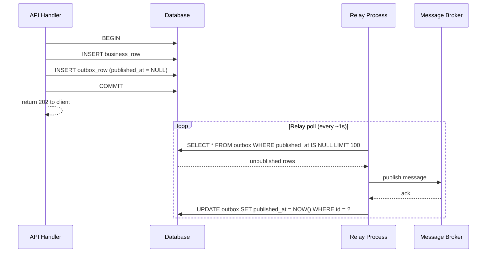

### 24.4 Relay Implementations

**Polling relay (BAPS default).** A cron-style loop queries `outbox WHERE published_at IS NULL`, publishes each row to the broker, and marks it published. Implementation complexity is low — any background worker framework from §22 can run the relay. Typical latency from commit to broker delivery is approximately 1 second, which is acceptable for all BAPS job categories.

**Log-based relay (ADR required).** A CDC tool such as Debezium tails the PostgreSQL WAL and reacts to `INSERT` events on the outbox table, publishing to the broker without polling. Latency is sub-100 ms. This approach requires additional infrastructure (Kafka Connect or a Debezium connector deployment) and expertise in WAL configuration and connector monitoring. Use only when polling latency is demonstrably insufficient and an ADR has been approved by the Infrastructure Lead.

### 24.5 Outbox Row Lifecycle

| State | Condition | Action |
| --- | --- | --- |
| Unpublished | `published_at IS NULL` | Relay will pick up on next poll |
| Published | `published_at IS NOT NULL` | Eligible for garbage collection after 7 days |

A scheduled job MUST delete outbox rows where `published_at < NOW() - INTERVAL '7 days'` to prevent unbounded table growth.

### 24.6 Failure Handling

- **Broker unavailable during publish** — the outbox row remains unpublished (`published_at IS NULL`). The relay retries on the next poll cycle. No intervention is required unless the broker is unavailable for longer than the acceptable delivery delay SLA.
- **Row published twice** — this occurs when the relay publishes successfully but the process crashes before marking `published_at`. The consumer MUST implement idempotency (§15) using the `message_id` from the envelope (§17). Duplicate delivery is expected and handled at the consumer; it is not treated as a relay bug.

### 24.7 When the Outbox is NOT Required

The outbox pattern is specifically for the case where a message must be delivered **if and only if a DB commit succeeds**. It is not required in the following situations:

- **Scheduler-triggered jobs** — the trigger is time, not a DB event. Enqueue directly.
- **Fan-out from an already-committed event** — if the source event is already durable (e.g., an EventBridge event that has been acknowledged), re-enqueueing from a consumer is idempotent by construction.
- **Read-only workflows** — no DB mutation means there is no commit to synchronize with.

When in doubt, prefer the outbox. The cost is a single additional row per business write; the benefit is guaranteed exactly-once delivery at the broker boundary.

---

## 25. KEDA Autoscaling

### 25.1 Requirement

Every worker deployment MUST use KEDA (`ScaledObject` or `ScaledJob`) for autoscaling. A plain `HorizontalPodAutoscaler` based on CPU or memory is not sufficient for queue-driven workloads because CPU and memory do not reflect the actual work signal: queue depth. A queue that is fully drained will show 0% CPU on idle consumers, which causes a CPU-based HPA to scale down correctly — but a queue that is growing under load may not produce elevated CPU until consumers are already overwhelmed. KEDA reads the queue depth or lag metric directly from the source system and scales accordingly.

### 25.2 ScaledObject vs ScaledJob

**`ScaledObject`** manages a `Deployment` (or `StatefulSet`) of long-running consumer pods that continually read from the broker. Use `ScaledObject` for:

- AWS SQS listeners that loop on `ReceiveMessage`
- Redis Streams consumer group members running `XREADGROUP`
- EventBridge target services polling or receiving push deliveries

**`ScaledJob`** creates one Kubernetes `Job` per trigger evaluation, with each Job processing a bounded batch of messages before exiting. Use `ScaledJob` only when the per-message processing cost is high (typically >30 seconds end-to-end) and job-per-message isolation provides a meaningful operational benefit — for example, when each message requires a separate container environment, GPU allocation, or audit trail. The overhead of Job creation makes `ScaledJob` unsuitable for high-throughput workloads.

### 25.3 Per-Source Trigger Reference

| Source | KEDA trigger type | Key threshold |
| --- | --- | --- |
| AWS SQS | `aws-sqs-queue` | `queueLength` (target messages per replica) |
| Redis Streams | `redis-streams` | `pendingEntriesCount` |
| PostgreSQL | `postgresql` | `query` returning pending count |
| Prometheus | `prometheus` | Custom metric (e.g., `dispatch_backlog`) |
| Cron | `cron` | Scheduled scale-up / scale-down |

### 25.4 Mandatory Configuration

All `ScaledObject` and `ScaledJob` resources MUST specify the following fields:

- **`minReplicaCount`** — set to `0` by default to allow full scale-down during idle periods. MUST be set to `≥1` for workers assigned to the `CRITICAL` or `TRANSACTIONAL` job lanes, to avoid cold-start latency when a message arrives.
- **`maxReplicaCount`** — MUST be set to a finite value justified in an inline comment in the manifest. Do not set to an arbitrarily large number; capacity planning governs the ceiling.
- **`cooldownPeriod`** — default `300` seconds (5 minutes). Prevents thrashing when queue depth fluctuates near the threshold. Override only when justified.
- **`pollingInterval`** — default `15` seconds. Controls how frequently KEDA checks the trigger source. Reduce only for latency-sensitive workloads with explicit Infrastructure Lead approval.

### 25.5 KEDA Control Loop

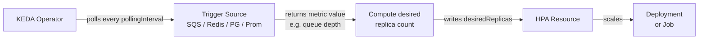

### 25.6 Sample ScaledObject — AWS SQS

```yaml
apiVersion: keda.sh/v1alpha1
kind: ScaledObject
metadata:
  name: dispatch-worker-sqs
  namespace: workers
spec:
  scaleTargetRef:
    name: dispatch-worker
  minReplicaCount: 2          # CRITICAL lane: must not cold-start (§14.1's worker-pool-min table)
  maxReplicaCount: 20         # capacity-planned ceiling for this queue
  cooldownPeriod: 300
  pollingInterval: 15
  triggers:
    - type: aws-sqs-queue
      metadata:
        queueURL: https://sqs.ap-south-1.amazonaws.com/123456789/dispatch-queue
        queueLength: "10"     # scale 1 replica per 10 messages in flight
        awsRegion: ap-south-1
        identityOwner: pod    # use pod IRSA; do not use static credentials
```

### 25.7 Sample ScaledObject — Redis Streams

```yaml
apiVersion: keda.sh/v1alpha1
kind: ScaledObject
metadata:
  name: ingest-worker-redis
  namespace: workers
spec:
  scaleTargetRef:
    name: ingest-worker
  minReplicaCount: 0          # STANDARD lane: scale to zero when idle
  maxReplicaCount: 10         # capacity-planned ceiling for this stream
  cooldownPeriod: 300
  pollingInterval: 15
  triggers:
    - type: redis-streams
      metadata:
        address: redis-primary.internal:6379
        stream: baps:ingest:events
        consumerGroup: ingest-worker-group
        pendingEntriesCount: "5"   # scale 1 replica per 5 pending entries
        enableTLS: "true"
```

### 25.8 Rollout Coordination

During deployment rollouts, KEDA may instruct the HPA to scale down replicas while those replicas are still processing messages. Workers MUST NOT terminate mid-message. Configure the pod spec with:

- **`terminationGracePeriodSeconds`** — set to a value greater than the maximum expected per-message processing time, plus a buffer of at least 30 seconds.
- **`preStop` hook** — add a `preStop` lifecycle hook that signals the consumer loop to stop accepting new messages and waits for in-flight processing to complete before the container exits.

Specific values for each technology are specified in §28 (Deployment & Rollout).

---

## 26. Per-Technology Implementation Guides

Each subsection below is a self-contained implementation guide for one supported technology. Read Part A (§5–§21) first: the technology-agnostic policies on idempotency (§15), envelope (§17), retry (§7), and DLQ (§21) govern all guides equally. Each guide cross-references those sections rather than restating policy. All guides share the same skeleton: setup, job or message registration, envelope handling, retry policy configuration, DLQ configuration, distributed lock (where applicable), observability integration, and distinctive gotchas.

---

### 26.1 Hangfire (.NET)

**Setup.** Install the following NuGet packages: `Hangfire.Core`, `Hangfire.AspNetCore`, and `Hangfire.PostgreSql`. PostgreSQL is the required storage backend for new systems, per the organization's standing decision to standardize on PostgreSQL wherever an RDBMS is needed — this is not a Hangfire-specific restriction invented by this section. In-memory storage is never permitted in production (job state must survive a restart). A small number of existing BAPS systems still run Hangfire against SQL Server; these are grandfathered, not newly compliant — no new system may adopt SQL Server for this purpose, and existing SQL Server-backed systems are expected to migrate to PostgreSQL over time as they come up for revision, not on a mandated deadline this standard sets unilaterally.

```csharp
builder.Services.AddHangfire(config => config
    .SetDataCompatibilityLevel(CompatibilityLevel.Version_180)
    .UseSimpleAssemblyNameTypeSerializer()
    .UsePostgreSqlStorage(connectionString));

builder.Services.AddHangfireServer();
```

**Job registration.** Register recurring jobs at application startup using a stable, globally unique job ID. The ID must match the service name and purpose to aid operational diagnosis:

```csharp
RecurringJob.AddOrUpdate(
    "dispatch-worker-daily-settlement",
    () => settlementService.Run(CancellationToken.None),
    Cron.Daily);
```

Enqueue one-off jobs (Category 2 — Deferred) via:

```csharp
BackgroundJob.Enqueue(() => notificationService.Handle(payload));
```

**Envelope handling.** Implement a custom `IJobFilter` (implements both `IClientFilter` and `IServerFilter`). In `OnCreating`, capture `Activity.Current.Id` as `traceparent` and read `correlationId` from the ambient context; store both as additional job parameters. In `OnPerforming`, reconstruct the `Activity` from stored `traceparent` so that downstream log entries and outbound HTTP calls carry the same trace context. Apply the filter globally via `GlobalJobFilters.Filters.Add(new EnvelopeJobFilter())`. Envelope structure follows §17.

**Retry policy.** Override the default retry policy, which retries 10 times silently. Apply `AutomaticRetryAttribute` explicitly on each job class:

```csharp
[AutomaticRetry(Attempts = 5, DelaysInSeconds = new[] { 30, 60, 180, 600, 1800 })]
// use Attempts = 0 when idempotency + DLQ replaces retry (see §15)
public class SettlementJob { ... }
```

When idempotency guarantees and a DLQ are in place (§15), set `Attempts = 0` to route failures directly to `FailedState` without in-process retry.

**DLQ.** Hangfire's `FailedState` is the functional DLQ. Implement a `JobFilterAttribute` that intercepts `OnStateApplied` transitions to `FailedState` and writes a record to the `background_job_dlq` table (§21.4) including job arguments, exception message, attempt count, and envelope fields. This export must be idempotent; use `INSERT … ON CONFLICT DO NOTHING`.

**Distributed lock.** Annotate recurring jobs with `[DisableConcurrentExecution(timeoutInSeconds: 300)]` to prevent the same job ID from running on multiple Hangfire server instances simultaneously. For cross-instance advisory locking on shared resources, use PostgreSQL advisory locks surfaced through `Hangfire.PostgreSql`'s connection provider.

**Observability.** Expose the Hangfire dashboard at `/hangfire`. The dashboard endpoint MUST be protected by the same authentication middleware as the management API; it must not be publicly accessible. Export Prometheus metrics (enqueued count, processing count, failed count, succeeded count) via the Hangfire Prometheus adapter. These metrics feed the standard SLO dashboards defined in §27.

**Gotchas.**

- The default `AutomaticRetryAttribute` retries 10 times. Always override explicitly; omitting the attribute does not mean zero retries.
- Jobs must be public methods on public classes. Hangfire serializes the method call by type and method name; internal or private methods cannot be deserialized across restarts.
- Long-running jobs must accept `IJobCancellationToken` (or `CancellationToken` via Hangfire adapter) and check it periodically. Without this, graceful shutdown requests (SIGTERM) will not interrupt in-progress jobs.
- Job arguments are serialized to JSON and stored in the database. Avoid passing large objects; pass identifiers and load data inside the job body.

---

### 26.2 Spring @Scheduled + ShedLock (Java)

**Setup.** Add the following dependencies: `spring-boot-starter` (scheduling support is included), `net.javacrumbs.shedlock:shedlock-spring`, `net.javacrumbs.shedlock:shedlock-provider-jdbc-template`, `org.springframework.retry:spring-retry`, and `org.springframework.boot:spring-boot-starter-aop` (required for `@Retryable` / `@Recover` AOP proxying). Enable scheduling and distributed locking in the application configuration class:

```java
@SpringBootApplication
@EnableScheduling
@EnableSchedulerLock(defaultLockAtMostFor = "30m")
public class Application { ... }
```

ShedLock requires a `shedlock` table in the application database; apply the DDL migration from the ShedLock documentation before deployment.

**Cron registration.** Annotate each scheduled method with both `@Scheduled` and `@SchedulerLock`. The `name` on `@SchedulerLock` must be globally unique across all services that share the same ShedLock table:

```java
@Scheduled(cron = "0 0 2 1 * *")
@SchedulerLock(
    name = "monthly-attendance-report",
    lockAtMostFor = "60m",
    lockAtLeastFor = "30m")
public void runMonthlyAttendanceReport() { ... }
```

`lockAtMostFor` is the maximum time the lock is held even if the pod crashes. It MUST exceed the worst-case job duration; if the job exceeds this duration the lock is released and a second instance may start a duplicate run. `lockAtLeastFor` prevents re-acquisition immediately after a fast completion in multi-pod environments.

**Envelope handling.** `@Scheduled` jobs are initiated by a timer, not a message, so there is no incoming envelope. Wrap the job body in a tracing template that either reads a `traceparent` from a producer-side record (for example, a DB row that triggered the job) or generates a synthetic root span per §18. Populate MDC with `correlationId` before any log statements execute inside the job body.

**Retry policy.** Apply `@Retryable` for transient failures within the job body, with a corresponding `@Recover` method that handles the final failure. For Category 1 (scheduled, fixed-interval) jobs, prefer deferring to the next scheduled fire rather than in-process retry: in-process retry can cause one pod to monopolize the lock beyond `lockAtMostFor`, leading to duplicate runs on the next pod.

**DLQ.** In the `@Recover` method (Spring Retry's final-failure handler), insert a record into `background_job_dlq` (§21.4) with the exception message, job name, scheduled fire time, and any available correlation fields.

**Gotchas.**

- Without ShedLock, `@Scheduled` fires on every pod independently, causing duplicate execution for every scheduled run. ShedLock is mandatory for any multi-pod deployment.
- `lockAtMostFor` must be set conservatively longer than the real job duration. If the job typically takes 10 minutes, set `lockAtMostFor` to at least 20 minutes. Underestimating this value is a common source of duplicate runs.
- Changing the `name` value on `@SchedulerLock` creates a new lock row and abandons any stale lock under the old name; coordinate name changes with a database cleanup.

---

### 26.3 Spring Batch (Java)

**Setup.** Add `spring-boot-starter-batch` as a dependency. Configure Spring Batch to use the application's PostgreSQL database as its `JobRepository`; disable the in-memory `MapJobRepository`. The Batch schema DDL is provided by the `spring-batch-core` artifact and must be applied via migration before the first run.

**Job structure.** Model each batch workload as a Spring Batch `Job` composed of one or more `Step` objects. Each `Step` uses the chunk-oriented processing model:

```text
Job → Step → Chunk (ItemReader → ItemProcessor → ItemWriter)
```

Define `commit-interval` explicitly on each step. The default of 10 rows is too low for most production batch workloads; tune per job based on row size, downstream write latency, and acceptable rollback scope.

**Restartability.** Spring Batch stores `JobExecution` and `StepExecution` state in `BATCH_JOB_EXECUTION` and `BATCH_STEP_EXECUTION`. A job interrupted mid-run can be restarted by submitting the same `JobParameters`. The step resumes from the last committed chunk checkpoint. Ensure `JobParameters` are unique per logical run (for example, include the target date or report period) so that re-submission restarts the correct execution rather than creating a new one.

**Envelope handling.** Propagate `correlationId` through `JobParameters` so it is available throughout all steps. Set MDC fields (`correlationId`, `jobName`, `stepName`) in `StepExecutionListener.beforeStep` callbacks for structured log correlation.

**Progress tracking.** Implement `ItemWriteListener.afterWrite` to emit incremental progress records to the `background_job_progress` table (§21) after each chunk commit. Write the item count processed in this chunk, cumulative count, and a timestamp. This gives operators real-time visibility into batch progress without querying Spring Batch schema tables.

**DLQ.** Implement `SkipListener` and register it on steps that tolerate per-item failures. In `onSkipInWrite` and `onSkipInProcess`, insert the skipped item's identifier, the exception message, and the job's `correlationId` into `background_job_dlq` (§21.4). Enable skip limits explicitly; without a `skipLimit`, Spring Batch does not invoke `SkipListener` and fails the step immediately on the first item error.

**Gotchas.**

- The default `commit-interval` of 10 rows produces excessive checkpoint writes under high-volume jobs. Tune this per job and document the chosen value in the TDD referencing this standard.
- Long-running steps must have step-level timeouts enforced at the resource level rather than via Spring Batch itself. Set connection and statement timeouts on the underlying `ItemReader` (for example, JDBC `queryTimeout` on the `DataSource`, or HTTP client read-timeout on a REST-based reader). Note that `StepBuilder.throttleLimit` controls concurrent thread count in a partitioned step, not elapsed time, and must not be used as a timeout mechanism.
- Spring Batch's restart logic relies on `JobParameters` uniqueness. If `JobParameters` are not carefully designed, re-submission creates a new execution rather than restarting the failed one.

---

### 26.4 Spring Cloud AWS SQS (Java)

**Setup.** Add `io.awspring.cloud:spring-cloud-aws-starter-sqs` as a dependency. Configure `SqsMessagingConfiguration` in the application context. The service pod must have an IAM role (via IRSA for EKS, or task role for ECS) that grants `sqs:ReceiveMessage`, `sqs:DeleteMessage`, `sqs:ChangeMessageVisibility`, and `sqs:GetQueueUrl` on the target queue. Do not use static AWS credentials embedded in configuration files.

**Listener registration.** Annotate the handler method with `@SqsListener`. Correlation and trace headers can be extracted directly via `@Header`:

```java
@SqsListener("baps-dispatch-queue")
public void handle(
    YourType payload,
    @Header("correlationId") String correlationId,
    @Header("traceparent") String traceparent) {
    // restore trace context; process payload
}
```

**Envelope handling.** Register a custom `MessageConverter` bean that deserializes the SQS message body as the standard envelope (§17), extracts `correlationId` and `traceparent` from the envelope or SQS message attributes, and populates MDC before invoking the handler. The converter ensures that all handler methods receive the unwrapped domain payload and that trace context is always propagated regardless of the handler's `@Header` annotations.

**Retry.** Configure the SQS queue's `redrivePolicy` with `maxReceiveCount = 5`. This is the primary retry mechanism: if the handler throws an exception, the message becomes visible again after the visibility timeout and is re-delivered. Do not additionally wrap handler bodies in synchronous retry loops; double-retry causes messages to exceed `maxReceiveCount` prematurely.

**DLQ.** Set the DLQ ARN in the queue's `redrivePolicy`. The DLQ queue name must follow the convention `<queue-name>-dlq`. A periodic background job (Category 1, scheduled daily or hourly) reads from the DLQ and inserts records into the `background_job_dlq` table (§21.4) for operator review and potential replay.

**Visibility timeout tuning.** Set the queue's default visibility timeout to 60 seconds. For handlers that process messages longer than 60 seconds, extend the timeout periodically (for example, every 30 seconds) by calling `SqsAsyncClient.changeMessageVisibility(ChangeMessageVisibilityRequest)` on the injected `SqsAsyncClient`; pass the receipt handle obtained from the `SqsMessage` context. Failure to extend visibility causes the message to be re-delivered to another consumer while processing is still in progress.

**Gotchas.**

- The default acknowledgment mode is `ON_SUCCESS`: the framework deletes the message automatically when the handler method returns normally. Throwing an exception makes the message visible again. Do not call `DeleteMessage` manually inside the handler; this creates a race condition with the framework's acknowledgment.
- Set the queue's `ReceiveMessageWaitTimeSeconds` to 20 (long polling). Without long polling, the consumer issues empty receives at high frequency, increasing SQS API costs significantly.
- Messages that fail `maxReceiveCount` times are moved to the DLQ by SQS automatically. Ensure the DLQ has a sufficient retention period (14 days recommended) to allow operator investigation.

---

### 26.5 AWS SQS + EventBridge (any SDK)

**Pattern.** The producer publishes an event to an EventBridge event bus. An EventBridge rule matches on event fields and routes the event to one or more SQS queues. Workers consume from SQS as described in §26.4. This pattern decouples the producer from the specific consumer topology and allows fan-out to multiple queues without producer changes.

**Rule matching.** Define EventBridge rules with JSON event pattern filters on `detail-type` (the logical event name) and `source` (the producing service identifier). Keep `detail-type` values in a central registry documented in the TDD for each service. Avoid broad wildcard patterns that match unintended event types.

**Redrive policy.** Apply a `redrivePolicy` with `maxReceiveCount` on the SQS target queue exactly as described in §26.4. EventBridge routing to SQS does not add retry logic; all retry semantics are governed by SQS queue configuration.

**Envelope handling.** EventBridge wraps the producer's payload in the `detail` field of the EventBridge event envelope. The worker reads the SQS message body, which contains the full EventBridge event JSON. The worker must first unwrap the EventBridge envelope to access `detail`, then unwrap the BAPS standard envelope (§17) within `detail` to access the domain payload and correlation fields.

**FIFO vs Standard queues.** Use SQS FIFO queues as EventBridge targets when per-key ordering is required (Category 4 jobs). Use Standard queues when throughput and parallelism matter more than ordering (Category 5 fan-out). EventBridge supports both queue types as rule targets; the choice must be documented in the TDD.

**Deduplication.** For FIFO queues, set `MessageDeduplicationId` to the idempotency key from the envelope. SQS FIFO deduplication windows span 5 minutes; ensure idempotency keys are stable across that window. Standard queues do not deduplicate; the consumer's idempotency guard (§15) is the sole protection against duplicate processing.

**Gotchas.**

- EventBridge applies its own per-target async retry policy: up to 3 delivery attempts over up to 24 hours before an event is dropped or sent to an EventBridge DLQ. For Category 5 high-volume jobs where explicit SQS-based DLQ control is required, this hidden retry loop can deliver a message to SQS long after the initial failure. If you want deterministic DLQ control, disable the EventBridge retry policy on the rule target and rely solely on SQS redrive.
- EventBridge has a maximum event size of 256 KB. Large payloads must use the claim-check pattern: store the payload in S3 and include only the S3 reference in the EventBridge event.
- Cross-account EventBridge routing requires explicit resource-based policies on the target event bus. Verify IAM policies in staging before production deployment.

---

### 26.6 Redis Streams + Consumer Groups (any Redis client)

**Pattern.** Producers write messages via `XADD`. One or more consumer groups read via `XREADGROUP`, which delivers each message to exactly one consumer in the group. The consumer calls `XACK` after successful processing, which removes the message from the pending-entries list (PEL). Messages that remain in the PEL beyond the idle threshold are reclaimed by a competing consumer via `XAUTOCLAIM`, preventing stuck messages when a worker crashes mid-processing.

**Setup.** Requires Redis 5.0 or later. Deploy Redis in Cluster or Sentinel configuration for high availability; standalone single-node Redis is not permitted for production workloads. Enable TLS on the Redis connection. Do not share a Redis instance between background job streams and the authentication cache (ORG-STANDARD-001); use separate logical databases or separate clusters.

**Consumer group creation.** Create the consumer group before any producer or consumer starts. Use `MKSTREAM` to create the stream automatically if it does not exist:

```redis
XGROUP CREATE baps:ingest:events ingest-worker-group $ MKSTREAM
```

The `$` offset means the group starts reading only new messages added after group creation. If catching up from the beginning of the stream is required, use `0` as the offset. Consumer group creation is an idempotent operation if the group name already exists and offset matches; wrap creation in error handling that ignores `BUSYGROUP` errors.

**Reclaim strategy.** Each worker instance runs `XAUTOCLAIM` at the start of its processing loop to claim messages idle longer than 30 seconds:

```redis
XAUTOCLAIM baps:ingest:events ingest-worker-group <consumer-id> 30000 0-0 COUNT 10
```

This prevents messages from being orphaned in the PEL when a worker pod is terminated without completing `XACK`. Set the idle threshold higher than the maximum expected per-message processing time.

**Envelope handling.** Redis stream entries are field/value pairs. The producer stores each envelope field (§17) as a named field in the stream entry: `correlationId`, `traceparent`, `idempotencyKey`, `jobType`, `payload` (JSON-encoded domain data). The consumer reads all fields from the entry, reconstructs the envelope, and validates required fields before processing.

**DLQ.** Redis Streams have no native DLQ. Implement a DLQ as a separate stream named `<stream-name>-dlq`. After N failed `XAUTOCLAIM` cycles on the same message (track attempt count in the PEL or in the message fields), the worker writes the message to the DLQ stream via `XADD` and `XACK`s the original to remove it from the PEL. Insert a corresponding record into the `background_job_dlq` table (§21.4) for operator review.

**Trim policy.** Apply `MAXLEN ~ 1000000` on each `XADD` call to bound stream memory growth:

```redis
XADD baps:ingest:events MAXLEN ~ 1000000 * correlationId <id> ...
```

The `~` modifier allows Redis to trim lazily for performance. Tune the limit based on available memory and the expected message arrival rate.

**Gotchas.**

- Redis Streams are not replicated cross-region by default. If the Redis cluster is unavailable, producers cannot enqueue and consumers cannot process. For cross-region resilience, pair Redis Streams with a fallback write path to an SQS queue, or document the accepted downtime in the TDD.
- Consumer group state (PEL, consumer registration) is stored per Redis instance. If the Redis cluster is replaced or restored from a backup, consumer group state may be lost, causing previously-acknowledged messages to reappear or pending messages to be lost.
- Unbounded stream growth causes memory pressure on the Redis cluster. Always apply `MAXLEN`; monitor stream length as a Prometheus metric.
- `XREADGROUP` with `BLOCK 0` blocks indefinitely. Use a finite block timeout (for example, `BLOCK 5000`) so that the consumer loop can check for shutdown signals and run `XAUTOCLAIM` on a predictable schedule.

---

### 26.7 BullMQ (NestJS) — Restricted

> **Applicability: legacy systems only.** BullMQ is supported exclusively for maintaining existing NestJS services that already use it. New NestJS services MUST NOT adopt BullMQ; they SHOULD use SQS (§26.4 or §26.5) or Redis Streams (§26.6) directly. Any proposal to adopt BullMQ in a new service requires an ADR with Architecture Lead approval.

**Setup.** Install `@nestjs/bullmq` and `bullmq`. Configure the Redis connection in the `BullModule.forRoot` registration. The Redis backend must be the same Redis instance used for BullMQ's job storage; do not share this instance with the authentication cache (ORG-STANDARD-001).

**Queue and worker registration.** Define a processor class using the `@Processor` decorator and extend `WorkerHost`:

```typescript
@Processor('baps-legacy-queue')
export class LegacyJobProcessor extends WorkerHost {
  async process(job: Job<LegacyJobPayload>): Promise<void> {
    const { correlationId, traceparent, payload } = job.data;
    // restore trace context; process payload
  }
}
```

Register the queue in the module with `BullModule.registerQueue({ name: 'baps-legacy-queue' })`.

**Envelope handling.** The BullMQ `job.data` object carries the full envelope (§17). When enqueuing, wrap the domain payload in the standard envelope before calling `queue.add`. Provide an envelope-injection helper function shared across all producers for this queue to ensure consistent field population.

**Retry configuration.** Configure retry policy in the `defaultJobOptions` on the queue:

```typescript
BullModule.registerQueue({
  name: 'baps-legacy-queue',
  defaultJobOptions: {
    attempts: 5,
    backoff: { type: 'exponential', delay: 1000 },
    removeOnComplete: false,
    removeOnFail: false,
  },
})
```

**DLQ.** BullMQ does not have a native DLQ. Listen for the `failed` event on the `Worker` instance. When a job exhausts all retry attempts, the `failed` event fires with the job object and the final error. In the `failed` handler, move the job data to a `-dlq` queue via a separate `Queue` instance and insert a record into the `background_job_dlq` table (§21.4).

**Gotchas.**

- BullMQ removes completed jobs from Redis by default. Always set `removeOnComplete: false` and configure an explicit retention count or time (for example, `removeOnComplete: { count: 1000 }`) to retain job history for debugging. Without retention, completed job records are unrecoverable.
- BullMQ's job storage is entirely Redis-backed. A single Redis instance is a single point of failure for both the queue and the worker coordination state. For legacy services using BullMQ, ensure Redis is deployed in Sentinel or Cluster mode and document the recovery procedure in the runbook.
- BullMQ uses Redis Lua scripts for atomic job state transitions. Redis Cluster compatibility requires all keys for a given queue to hash to the same slot; BullMQ handles this via `{}` hash tags in key names, but verify compatibility if using a non-standard Redis Cluster proxy.
- The `@Processor` decorator registers a NestJS provider. If the module containing the processor is not imported in the root module, the processor will not start and no jobs will be consumed — this failure is silent at startup.

---

## 27. Observability Standards

Every background worker deployment MUST emit structured logs, expose standard Prometheus metrics, and publish a Grafana dashboard conforming to the layout in §27.3.

### 27.1 Structured Log Envelope

Every log line emitted during job processing MUST be JSON and MUST include all twelve fields in the envelope below. Fields missing at emit time (for example `traceId` when no incoming trace header was propagated) MUST be set to `null`, not omitted.

```json
{
  "@timestamp": "ISO-8601",
  "level": "INFO|WARN|ERROR",
  "logger": "class or handler name",
  "message": "human-readable",
  "correlationId": "uuid",
  "traceId": "hex",
  "spanId": "hex",
  "jobId": "uuid",
  "jobType": "welcome-email",
  "jobStatus": "PENDING|RUNNING|SUCCEEDED|FAILED|DLQ",
  "attempt": 1,
  "service": "sampark|mybky|ems|gms",
  "environment": "dev|uat|prod"
}
```

The `correlationId` MUST be the value propagated from the originating request (§18). The `traceId` and `spanId` MUST be the current OpenTelemetry span values. Log lines emitted outside of a job context (for example, worker startup events) MUST still include all fields; set `jobId`, `jobType`, `jobStatus`, and `attempt` to `null` in that case.

### 27.2 Standard Metric Names

All job-level metrics in this table use the `background_job_` prefix and follow Prometheus naming conventions — the process-level resource gauges in §27.5 use a distinct `worker_process_` prefix, since they measure the worker process itself, not any individual job. Histograms MUST expose `_bucket`, `_sum`, and `_count` suffixes automatically via the instrumentation library.

| Metric | Type | Labels | Meaning |
| --- | --- | --- | --- |
| `background_job_enqueued_total` | Counter | `job_type, priority, service` | Enqueue count |
| `background_job_started_total` | Counter | `job_type, priority, service` | Start count |
| `background_job_succeeded_total` | Counter | `job_type, priority, service` | Success count |
| `background_job_failed_total` | Counter | `job_type, priority, service, reason` | Failure count |
| `background_job_retried_total` | Counter | `job_type, priority, service` | Retry count |
| `background_job_dlq_total` | Counter | `job_type, priority, service, reason` | DLQ count |
| `background_job_duration_seconds` | Histogram | `job_type, priority, service` | End-to-end duration |
| `background_job_queue_age_seconds` | Gauge | `queue, priority, service` | Oldest un-dequeued message age |
| `background_job_dlq_size` | Gauge | `queue, service` | DLQ backlog |
| `background_job_worker_replicas` | Gauge | `deployment, service` | Live replica count |

The `reason` label on `background_job_failed_total` and `background_job_dlq_total` MUST be a low-cardinality string (for example `TIMEOUT`, `VALIDATION_ERROR`, `PROVIDER_ERROR`) — never a raw exception message.

### 27.3 SLO Alerts

Every system deploying background workers MUST configure the following four alerts. Severity mappings follow the priority lanes defined in §13.

- `background_job_queue_age_seconds > lane_slo` for 5 minutes → PAGE (severity determined by lane; CRITICAL lane always pages on-call).
- `background_job_dlq_size > 0` for 15 minutes → **PAGE for the CRITICAL and TRANSACTIONAL lanes; NOTIFY for the STANDARD, BULK, and HOUSEKEEPING lanes.** Severity is lane-dependent, not a single fixed level for this alert.
- `failure_rate (failed_total / started_total) > 5%` over a 10-minute window → NOTIFY.
- `background_job_worker_replicas == 0 AND background_job_queue_age_seconds > 60` → PAGE (no workers consuming a non-empty queue).

### 27.4 Standard Grafana Dashboard

Every system MUST publish a Grafana dashboard following the canonical template row layout: Ingest → In-flight → Outcome → DLQ → SLOs → Runbook link. The dashboard MUST be version-controlled alongside the worker deployment manifests.

### 27.5 Resource-Growth Monitoring for Long-Running Workers

A worker process that runs for hours or days (any lane other than a short-lived Category 5/6 invocation) is exposed to a failure mode the per-job metrics in §27.2 cannot see: a slow memory or file-descriptor leak that has nothing to do with any single job's own correctness, and only manifests after many hours of cumulative execution. A job-level "succeeded" metric stays green for the entire time the process is quietly running out of memory underneath it.

**Mandatory resource-growth SLI.** Every long-running worker process MUST export process-level resource gauges, sampled at a fixed interval, in addition to the job-level metrics in §27.2:

| Metric | Type | Meaning |
| --- | --- | --- |
| `worker_process_rss_bytes` | Gauge | Resident memory of the worker process |
| `worker_process_open_fds` | Gauge | Open file descriptors (sockets, files) held by the process |
| `worker_process_uptime_seconds` | Gauge | Time since the current process instance started |

**Alerting.** A sustained, monotonic upward trend in `worker_process_rss_bytes` (or `worker_process_open_fds`) over a multi-hour window — not a single spike, which is normal under load — MUST raise a NOTIFY-severity alert per ORG-STANDARD-006 §10.1: this is a degrading-trend signal, not yet a user-facing symptom, so it does not warrant a PAGE on its own. If the trend continues unmitigated until the process approaches its container memory limit (§28's deployment manifests already declare this limit), that is a different, symptom-based condition — an imminent OOM-kill — and MUST separately raise a PAGE via the platform's own container-resource alerting (e.g., a Kubernetes `OOMKilled`/near-limit event), not a duplicate of this NOTIFY. This standard does not itself define that platform-level alert; it only requires that one exists and is distinct from the NOTIFY-severity trend signal above.

**Scheduled-restart safety net.** Root-causing every slow leak before it affects production is not always practical on a useful timeline. Where a leak's root cause is not yet fixed, a system MAY mitigate it with a scheduled, staggered rolling restart of the affected worker pool (e.g., nightly, or every N hours, tuned to comfortably outrun the observed growth rate) — reusing §28.1's rolling-deployment mechanics and §28.2's graceful-shutdown discipline so a scheduled restart drains in-flight work exactly as a deployment rollout would, rather than a raw process kill. This is an explicitly temporary mitigation, not a substitute for fixing the leak: the resource-growth SLI above MUST remain in place after a scheduled restart is introduced, both to confirm the restart cadence is actually outrunning the growth rate and to detect if the underlying leak gets worse and needs the cadence tightened.

**Anti-pattern:** introducing a scheduled restart as a permanent fix and then removing the resource-growth monitoring that motivated it — this converts a visible, trending problem into an invisible one that only resurfaces if the leak's growth rate later outpaces the restart cadence, with no alerting left to catch that.

---

## 28. Deployment & Rollout

### 28.1 Deployment Strategy

Workers MUST be deployed with a rolling strategy configured as `maxUnavailable=0` and `maxSurge=1`. Workers are stateful during message processing — a pod that is terminated mid-message will leave the message invisible in the queue until the visibility timeout expires. Setting `maxUnavailable=0` ensures at least the current replica count remains healthy during rollout, preventing involuntary mid-message termination.

### 28.2 Graceful Shutdown

All workers MUST handle shutdown gracefully. Three requirements apply:

- `terminationGracePeriodSeconds` MUST be set to at least 60 seconds. For job types with a worst-case execution time exceeding 30 seconds, set `terminationGracePeriodSeconds` to `worst_case_execution_time × 2` to ensure in-flight messages can complete before the process is killed.
- A `preStop` hook (or equivalent lifecycle signal) MUST trigger the worker to stop accepting new messages from the queue and drain its in-flight work before Kubernetes sends SIGTERM.
- The SIGTERM handler MUST complete all in-flight job processing, ACK the message to the broker, and then exit with code 0. It MUST NOT exit before ACKing; doing so would cause the broker to re-deliver the message and risk double-processing.

### 28.3 KEDA-Aware Rollouts

During a rolling deployment, KEDA continues to scale worker replicas based on queue backlog. Do not set the `replicas` field on the Deployment manually during a rollout — doing so conflicts with KEDA's scaling decisions and can leave the deployment in an unexpected state. Trust KEDA to maintain the correct replica count throughout the rollout.

### 28.4 Blue/Green Deployments (High-Risk Changes)

For high-risk changes — such as payload schema migrations, DLQ drains, or major logic rewrites — teams MAY deploy a parallel blue/green stack. The new version is deployed as a separate Deployment (green); traffic is shifted from the old version (blue) by adjusting the `ScaledObject` selector labels on the KEDA `ScaledObject` to point at the green Deployment. This allows gradual, observable traffic shifting without a DNS or ingress change. Once green is stable, the blue Deployment is scaled down and removed.

### 28.5 Rollback

To roll back a faulty deployment, revert the Deployment manifest to the previous version and apply it. The rolling strategy ensures zero-downtime reversal. For logic bugs that do not require a full rollback, the feature flags defined in §30 provide an instant kill-switch without any deployment action.

---

## 29. Health Probes

Every worker pod MUST expose three HTTP probe endpoints. The probe paths are fixed; teams MUST NOT use alternative paths.

### 29.1 Probe Definitions

**`/livez` — Liveness probe.** Returns HTTP 200 if the process is running and its internal event loop is responsive. Returns HTTP 503 if the process is fatally stuck (for example, deadlocked threads or an unrecoverable internal error). This probe MUST NOT gate on external dependencies such as the message broker, Redis, or downstream APIs. A transient external outage MUST NOT cause the pod to be restarted.

**`/readyz` — Readiness probe.** Returns HTTP 200 only when the worker is fully ready to consume messages: all required dependencies are healthy, any startup warmup has completed, and the feature flag for the worker is not in a kill-switch state (§30). Returns HTTP 503 in any other condition. A 503 response causes Kubernetes to remove the pod from service endpoints and instructs KEDA to exclude it from scaling calculations.

**`/healthz/jobs` — Job-level health surface.** Returns a JSON array containing one entry per registered job type. Each entry includes the last successful execution timestamp, the current DLQ size for that job type, and the current in-flight count. This endpoint is for monitoring systems only and MUST NOT be configured as a Kubernetes liveness or readiness probe.

### 29.2 Probe Usage by Component

| Probe | Kubernetes Usage | Failure Effect |
| --- | --- | --- |
| `/livez` | `livenessProbe` | Pod is restarted by kubelet |
| `/readyz` | `readinessProbe` | Pod removed from KEDA scaling and service endpoints |
| `/healthz/jobs` | Not used by Kubernetes | Scraped by monitoring systems only |

### 29.3 Warmup Blocking (Category 6 Workers)

Category 6 workers (§8) load in-memory lookup data during startup before they can process messages correctly. For these workers, `/readyz` MUST return HTTP 503 until the in-memory data load is complete. A worker that passes readiness before its warmup data is loaded will process messages with stale or absent data, producing silent correctness failures.

### 29.4 Sample `/healthz/jobs` Response

```json
[
  {
    "type": "welcome-email",
    "lastSuccessAt": "2026-07-15T10:42:00Z",
    "dlqSize": 0,
    "inFlight": 2
  },
  {
    "type": "membership-renewal-reminder",
    "lastSuccessAt": "2026-07-15T10:40:15Z",
    "dlqSize": 3,
    "inFlight": 0
  }
]
```

Fields are defined as: `type` — the registered job type string matching the envelope `type` field (§17); `lastSuccessAt` — ISO-8601 timestamp of the most recent successful completion for this job type, or `null` if no successful run has occurred since the worker started; `dlqSize` — current count of messages in the DLQ for this job type; `inFlight` — number of messages currently being processed.

---

## 30. Feature Flags in Jobs

### 30.1 Requirement

Every job type MUST have a corresponding boolean feature flag named `bg.job.<job-name>.enabled`. When the flag value is `false`, the job handler MUST return immediately without performing any work — no idempotency check, no state read, no downstream call.

### 30.2 Flag Check Placement

The flag check MUST be the absolute first statement in the job body, before the idempotency check (§15), before any state read, and before any logging beyond a single "job disabled, returning" line. This placement ensures that a disabled job imposes zero side-effects and near-zero latency overhead.

Pseudocode:

```text
FUNCTION process(job):
  IF NOT featureFlag("bg.job." + job.type + ".enabled"):
    LOG level=INFO message="job disabled by feature flag, returning"
    RETURN
  END IF
  // idempotency check (§15)
  // business logic
END FUNCTION
```

### 30.3 Gradual Rollout

For new job types being introduced into production for the first time, a percentage flag `bg.job.<job-name>.rollout_pct` MAY be used. The job handler checks this value (0–100) and dispatches processing only for the eligible fraction of entities, determined by a stable hash of the entity identifier modulo 100. This allows controlled exposure before full enablement.

### 30.4 Kill-Switch Scenarios

The instant kill-switch capability of feature flags covers the following operational scenarios without requiring a deployment:

- Downstream provider is down or degraded → flip `bg.job.<job-name>.enabled` to `false`; jobs drain back to queue or DLQ without further processing attempts until the flag is re-enabled.
- Bug discovered in a newly deployed job type → flip flag to `false` within minutes of detection; no rollback deployment required.
- A BULK lane job is flooding infrastructure and blocking CRITICAL lanes → temporarily disable the BULK job to free worker capacity for priority traffic.

### 30.5 Flag Storage and Reading

Systems SHOULD source feature flags from a shared config service (AWS AppConfig, ConfigCat, or LaunchDarkly). Flag reads MUST be local-cache-first: the flag value is fetched at worker startup and served from in-process memory during job execution. Flag reads MUST NOT be performed per-message — this would introduce a synchronous remote call on the hot path of every job and risk cascading latency if the config service is slow.

**A refresh interval is mandatory, not optional.** The in-process cache MUST poll the config service for updates at least every 30 seconds. "Fetched once at worker startup" alone — with no refresh interval — is not a compliant configuration: it would leave the kill-switch unable to take effect until the next pod restart, directly contradicting the "within seconds" guarantee in Design Principle 4. A refresh interval of 30 seconds or less is what makes that guarantee achievable in practice.

### 30.6 Auditability

Every flag toggle (enable or disable) MUST be recorded in the system's audit log with: actor (the user or service account that made the change), timestamp, flag name, previous value, new value, and a mandatory reason field. This audit trail is required for post-incident review and compliance.

---

## 31. Testing Standards

### 31.1 Unit Test Coverage Required per Job

Every job handler MUST have unit tests covering the following five cases:

1. **Happy path** — message processed successfully; verify the correct side effect is produced (row inserted, downstream call made, status updated to `SUCCEEDED`).
2. **Retry-able error (transient failure)** — inject a transient error (e.g., network timeout, DB connection error); verify the handler raises a retry-able exception, the job status is set to `RETRYING`, and on the subsequent simulated call the job succeeds.
3. **Non-retry-able error (business validation)** — inject a business-domain error (e.g., invalid entity reference, schema validation failure); verify no retry occurs and the message is routed to the DLQ with the appropriate failure reason (e.g., `invalid_envelope`).
4. **Timeout** — simulate a handler execution that exceeds the deadline defined in §7 Design Principle 5; verify the timeout is handled per that deadline-bounded policy and the message is not silently lost.
5. **Poison message (malformed envelope)** — supply a message that fails schema validation (missing required fields, wrong type, unrecognized version); verify the handler routes to the DLQ with reason `invalid_envelope` and does not attempt business logic execution.

Unit tests must not depend on external services. All broker, DB, and flag interactions are mocked or stubbed.

### 31.2 Integration Test Coverage

Integration tests verify the full processing path through real infrastructure components, not mocks. The following three areas must be covered:

1. **Real broker** — use LocalStack (`localstack/localstack:3.6`) for SQS and EventBridge; use Testcontainers with a Redis container for Redis-backed workers. Messages must be placed on the actual queue and consumed by the actual handler under test.
2. **Real DB** — use Testcontainers with `postgres:15-alpine`. The integration test must exercise actual SQL writes to `background_job` tables and verify row state after processing.
3. **Real or mocked feature flag** — use the real feature flag service if it is available in the integration test environment and does not introduce prohibitive latency. A mock or local override file is acceptable for latency-sensitive integration pipelines.

### 31.3 Idempotency Test (Mandatory)

Every job handler that writes state MUST have an idempotency test. The test replays the same message three times consecutively using the same `messageId` and verifies that exactly one side effect has occurred — one row inserted, one email sent, one status updated. The test must also confirm that the second and third replays complete without error (no exception, no DLQ routing) even though they produce no new effect.

This test is mandatory for all job categories and cannot be waived.

### 31.4 Load Test

A peak load test must be executed before the job type is promoted to production for the first time, and again after any change with a material capacity/latency impact. This section is the canonical definition of BAPS's load-testing methodology — ORG-STANDARD-004 §55.3 and ORG-STANDARD-008 §15 both reference it rather than restating it, since the methodology (test types, workload model, environment requirements, report structure) is the same regardless of whether what's under test is a background job or a synchronous API.

#### 31.4.1 Test Types

A single "2× peak" run answers only one question — most systems need more than one test type to be genuinely load-tested, not just peak-tested:

| Type | What it validates | When required |
| --- | --- | --- |
| **Peak load** | The system handles 2× expected peak throughput without breaching SLOs | Every job type, before first production promotion (the baseline requirement this section has always had) |
| **Stress test** | Load is raised in stages beyond expected peak until the system's actual breaking point is found — so the real ceiling, not just "it survived 2×," is known | Category 4/5 job types (the same categories §31.5 already requires a chaos test for), or any job type undergoing a significant architecture change. Distinct from the chaos test: stress finds the ceiling by escalating load; chaos finds resilience by injecting failure at a fixed load |
| **Spike test** | A sudden, short-duration surge (not a gradual ramp) and the system's recovery time back to steady-state latency afterward | Any job type whose real-world traffic pattern includes sudden bursts (e.g., a campaign-driven ingest) — the runbook (§33) MUST state whether this applies to a given job type |
| **Soak / endurance test** | Sustained load over an extended duration (hours, not minutes) to surface slow leaks — memory growth, connection-pool exhaustion, creeping latency — that a short run cannot reveal | Category 4 job types, or a Category 5 job type implemented as a continuously-running worker rather than short-lived per-message invocations — matching exactly the population §27.5's resource-growth monitoring already scopes itself to (§27.5 explicitly excludes short-lived Category 5/6 invocations; a soak test is only meaningful, and §27.5's SLI only exists, for the long-running shape) |

#### 31.4.2 Workload Model

The load-test plan MUST state, before the run: whether the model is **closed** (a fixed number of virtual users/workers, each waiting for a response before issuing its next request) or **open** (requests arrive at a target rate regardless of in-flight completions) — the two produce materially different results once the system approaches saturation, and results from runs using different models are not comparable to each other. The plan MUST also state whether think-time (a pause between a simulated caller's requests) is applied, and whether reported metrics are taken from a steady-state slice of the run or the full run including ramp-up/ramp-down. A report with none of this stated is not interpretable, even if the raw numbers look fine.

#### 31.4.3 Environment & Data Requirements

The load-test environment MUST use a data volume representative of production scale, per ORG-STANDARD-011 §10.2's environment-parity threshold — a load test against a near-empty database validates nothing about production behavior. Running the test against production itself is permitted only for a brand-new job type with no existing traffic to disrupt; an already-live job type MUST be load-tested in a non-production environment meeting the data-volume requirement instead.

#### 31.4.4 Baseline Run

Before the full-scale test, a low-load calibration run MUST be executed first, to confirm the test scripts, test data, and monitoring pipeline are actually working correctly — a full-scale run against a broken harness produces a misleading result, not a validated system. The specific load level for this calibration run is a per-system/per-job-type decision; this standard does not mandate a fixed number.

#### 31.4.5 Report Requirements

A load test report must be attached to the PR that introduces or materially changes the job type, and must measure and record, for the peak-load test at minimum:

- Worker replica scale-up — verify KEDA triggers additional replicas before the queue depth breaches the configured threshold.
- Latency p99 — end-to-end time from message enqueue to `SUCCEEDED` status at 2× load.
- DLQ growth rate — confirm the DLQ remains empty or grows at an acceptable rate under peak load (no failure amplification).

Beyond the raw metric data and an engineer's interpretation against the job's SLOs (runbook, §33), the report MUST also:

- Separate the observed error rate into **server-side** (5xx / job failure) and **client-side/generator-side** (timeout, connection reset) categories — a timeout with zero server-side errors indicates a slow response, not a broken one, and conflating the two misreads the result.
- State explicitly whether the load generator itself became the bottleneck (hit its own virtual-user/throughput ceiling, or dropped iterations) — a generator-limited run understates the system's true capacity and MUST NOT be reported as if it found the system's actual ceiling.
- Quantify headroom against the target (e.g., "sustained 2.3× peak before p99 breached SLO," not only "passed at 2× peak").
- Reference the raw data artifacts by name and location, so a later re-examination doesn't require re-running the test.

#### 31.4.6 Retest After Remediation

Where a load test fails and the system is subsequently changed to address the failure, the retest report MUST explicitly compare its results against the original failing run's numbers, not just report pass/fail in isolation — this is what makes "did the fix actually work, and by how much" answerable rather than assumed.

### 31.5 Chaos Test (Required for Category 4 and 5)

Job types classified as Category 4 (Event-Reactive) or Category 5 (High-Throughput Ingest/Dispatch) must pass a chaos test before production. The chaos test exercises three failure scenarios:

- **Broker outage (60 seconds)** — the message broker is made unavailable for 60 seconds while the worker is processing messages. Verify that the worker does not crash, does not lose in-flight messages, and resumes processing within 5 minutes of broker availability being restored.
- **DB outage (30 seconds)** — the database is made unavailable for 30 seconds. Verify that transient DB errors are treated as retry-able (not DLQ), that the idempotency table write is retried, and that no duplicate side effects occur after recovery.
- **Worker OOM (Out of Memory)** — inject memory pressure until the worker process is killed. Verify that the message visibility timeout has not expired (message returns to queue for reprocessing by a healthy worker), and that the replacement worker processes the message exactly once.

Recovery within 5 minutes and zero data loss are the acceptance criteria. Transient failures during chaos must not route to the DLQ unless the full retry budget has been exhausted.

### 31.6 DLQ Replay Test

A DLQ replay test must be executed in the staging environment before the job type is promoted to production. The test places a message on the DLQ (simulating a prior failure), invokes the DLQ replay endpoint or command defined in the runbook (§33.3, item 8), and verifies end-to-end that the replayed message is processed successfully and the correct side effect occurs.

This test confirms that the replay path, not only the primary processing path, is functionally correct.

---

## 32. Local Development

### 32.1 AWS Emulation

Local development environments use LocalStack to emulate AWS services. The container image is `localstack/localstack:3.6`. LocalStack provides SQS (queue creation, send, receive, delete, DLQ routing), EventBridge (rules and event buses), and S3 (claim-check object storage). Workers must be configurable to point at LocalStack endpoints via environment variables so that no code change is required between local and cloud deployments.

### 32.2 Redis

Local Redis is provided via Testcontainers using the image `redis:7-alpine`. Workers that use Redis for distributed locking (§12) or job state caching are configured to connect to the Testcontainers-managed Redis instance in test and local development modes.

### 32.3 PostgreSQL

Local PostgreSQL is provided via Testcontainers using the image `postgres:15-alpine`. The database schema (§21 data model) is applied via the system's existing migration tooling against the Testcontainers-managed instance.

### 32.4 docker-compose Template

Every system implementing background workers MUST maintain a `docker-compose.yml` file in its repository that provisions the mandatory local infrastructure services. The mandatory services are: LocalStack (for SQS, EventBridge, and S3 emulation), a Redis container (`redis:7-alpine`), and a PostgreSQL container (`postgres:15-alpine`). Systems may add additional services appropriate to their stack. The `docker-compose.yml` is owned by the implementing team and must be kept up to date as the system's infrastructure dependencies evolve. This standard does not prescribe the exact compose file content, as service naming, port assignments, and volume configuration vary by system; the mandate is that local infrastructure is containerized and not reliant on shared or cloud-hosted services during local development.

### 32.5 KEDA Local Development

KEDA autoscaling (§25) is not required for local development environments. Workers are run with a fixed replica count locally, sufficient to process the reduced message volumes used in development and testing. Engineers who need to validate KEDA scaling behavior should do so in the shared staging environment, which runs full KEDA configuration.

### 32.6 Feature Flag Emulation

Feature flag values in local development are provided via a local override file or environment variables. The override file contains key-value pairs of flag names and boolean values. When a local override is present, the flag client reads from it instead of the remote config service. This allows engineers to toggle flags without access to the shared config service. The override file must not be committed to version control.

### 32.7 Sample Local Flow

Start all infrastructure services with `docker compose up`, then start the producer service to enqueue test messages and the worker process to consume them; end-to-end processing can be observed via a local Grafana and Loki stack (optional, included in the compose file if the team chooses to include it).

---

## 33. Runbook Standards

### 33.1 Requirement

Every job type following this standard MUST have an operational runbook. The runbook is a merge blocker: a pull request that introduces a new job type to a system's codebase must include the completed runbook. A PR without a runbook will not be merged.

### 33.2 Runbook File Location

The runbook for each job is located at `docs/runbooks/<job-name>.md` in the system's own repository. The `<job-name>` value matches the `jobType` string registered in the envelope (§17) and the feature flag name suffix used in §30.

### 33.3 Mandatory Sections

Every runbook must contain the following ten sections in this order:

1. **Overview** — one paragraph describing what the job does, why it exists, and who depends on its output.
2. **Category & Priority** — the §8 category number and the §13 priority tier for this job.
3. **SLOs** — the latency target (p99 duration), success rate target, and DLQ tolerance threshold for this job, with links to the corresponding Grafana panels.
4. **Alerts** — every alert wired to this job type, with the alert condition (PromQL or equivalent expression), severity level, and notification target. Where ORG-STANDARD-006 is in force: PAGE-severity alerts MUST target a PagerDuty routing key (ORG-STANDARD-006 §10.3); NOTIFY-severity alerts MAY target a Slack channel instead.
5. **Escalation** — the on-call rotation name, the secondary contact for escalations beyond on-call, and the business owner who can authorize emergency remediation actions.
6. **How to check current state** — the Grafana dashboard link, the Loki or Elasticsearch log query to isolate this job's log stream, and the DB query to inspect current job status distribution.
7. **How to pause the job** — the exact feature flag name (`bg.job.<job-name>.enabled`) and the exact command or config service procedure to set it to `false`, including any safety checks that must be completed before disabling.
8. **How to replay from DLQ** — the exact command or admin endpoint to trigger DLQ replay, including the pre-replay safety checklist (root cause confirmed, idempotency verified, on-call notified).
9. **Known failure modes** — a table of observed or anticipated failure scenarios with columns: symptom, likely cause, and resolution steps.
10. **Historical incidents** — a chronological list of major incidents involving this job type, each with a date, a one-line summary, and a link to the post-mortem.

### 33.4 Template

The canonical runbook template is provided at `org_standards/templates/runbook-template.md` in this repository. Teams must copy the template to their system's repo and fill in all placeholder values before submitting the PR for review. The template itself must not be modified.

### 33.5 Grafana Alert Integration

Every Grafana alert wired to a background job MUST include a `runbook_url` annotation. The `runbook_url` value must link directly to the relevant section of the runbook (e.g., `https://<repo-url>/docs/runbooks/<job-name>.md#how-to-pause-the-job`) so that an on-call engineer receiving a page can navigate to remediation instructions without searching. Alerts without a `runbook_url` annotation will not pass the observability review gate.

### 33.6 Review Requirement

The runbook is reviewed as part of the PR review. Reviewers must confirm that all ten mandatory sections are present and populated (not left as template placeholders), that SLOs match the load test results from §31.4, that alert conditions reference the correct metric labels from §27, and that the DLQ replay instructions have been verified by the §31.6 DLQ replay test.

---

## 34. Security Requirements

### 34.1 Secrets Management

All credentials used by worker services — broker connection strings, provider API keys, database passwords, KMS key references, and config service tokens — MUST be stored in AWS Secrets Manager or Azure Key Vault. No plaintext credentials may appear in configuration files, environment variable definitions committed to version control, Kubernetes manifests, Helm values files, or any other artifact stored in a code repository. Workers retrieve secrets at startup from the secrets manager and inject them into the process environment or configuration objects. Secret rotation must be supported: workers must re-read the secret on a configurable refresh interval without requiring a restart.

### 34.2 Transport Layer Security

All broker connections MUST use TLS. SQS connections are HTTPS by default and must not be downgraded. Redis connections MUST use TLS 1.2 or higher; plain TCP Redis connections are not permitted in production. EventBridge and S3 connections are HTTPS-only by AWS design. Workers must validate TLS certificates and must not disable certificate verification in production configurations.

### 34.3 IAM Least Privilege

The IAM role assigned to each worker service MUST be scoped to the minimum permissions required for that worker's specific queue. For SQS-backed workers, the role must include exactly: `SQS:ReceiveMessage`, `SQS:DeleteMessage`, and `SQS:ChangeMessageVisibility` on the specific queue ARN for that worker. The role must not include `SQS:SendMessage` unless the worker also produces messages (in which case the send permission must be scoped to the specific target queue ARN). Wildcard resource grants (`Resource: "*"`) are not permitted. Cross-account access must be explicitly justified in an ADR.

### 34.4 Database Permissions

The database user used by each worker MUST be granted only the minimum database permissions required for that worker's job logic. Workers have INSERT and UPDATE access on `background_job*` tables (§21). Workers have SELECT access on the specific business tables they must read for job execution. Workers have no DELETE, TRUNCATE, DROP, CREATE, ALTER, or other DDL permissions. Workers have no access to tables or schemas outside their system's domain. Cross-schema reads require explicit justification in the system's TDD.

### 34.5 Payload Encryption

Payload data is protected at three layers:

- **In transit:** TLS as specified in §34.2 covers all broker and DB connections.
- **At rest (broker-side):** SQS queues must be configured with SSE-KMS (server-side encryption with a KMS customer-managed key). Redis clusters on AWS ElastiCache must have encryption at rest enabled in addition to TLS. EventBridge events are encrypted at rest by AWS using managed keys by default; systems requiring KMS-CMK encryption at rest must configure this explicitly.
- **At rest (claim-check objects):** S3 objects used for large payload storage (§20) must be encrypted with SSE-KMS using a system-owned KMS key. The worker must verify SSE configuration when writing objects and must reject reads from unencrypted buckets.

### 34.6 PII Handling

Job payloads that carry personally identifiable information (email addresses, phone numbers, names, membership identifiers) must minimize raw PII exposure in the message body. The `message_dispatch` record's `recipient_ref` field (§21) stores a stable hash of the recipient identifier, not the raw value, so that non-privileged operators inspecting job records or DLQ messages cannot extract PII without access to the hashing key. Systems that must include raw PII in payloads for processing (e.g., email delivery jobs) must document this in their TDD and restrict DLQ access to privileged roles only.

### 34.7 Audit Logging

Every admin operation performed against background job infrastructure must be audit-logged. Audit-logged operations include: DLQ message replay (single or batch), feature flag toggle (enable or disable per §30.6), DLQ clear (bulk delete of DLQ messages), and job status manual override. Each audit log entry must capture: actor (the authenticated user or service account identity performing the action), timestamp (ISO-8601 UTC), resource (the queue ARN, job type, or flag name being acted upon), and action (a human-readable description of what was done). Audit logs must be written to an append-only log store that is inaccessible to the actor performing the operation — audit self-modification is not permitted.

### 34.8 Vulnerability Scanning

Every worker container image must be scanned for known vulnerabilities as part of the CI pipeline. The scan must run against the production image tag before it is promoted to the staging or production environment. A HIGH or CRITICAL severity finding in the scan is a deployment blocker: the image must not be deployed until the finding is remediated. MEDIUM findings must be tracked and remediated within the team's standard vulnerability SLA. Scan results must be accessible to the security team and retained for a minimum of 12 months.

---

## 35. Migration Guide

This section defines how existing BAPS systems adopt ORG-STANDARD-002 progressively, without requiring a big-bang migration. The goal is 100% compliance across all background jobs within 365 days of standard approval while preserving system stability during the transition.

### 35.1 Migration Principles

- **New work follows the standard from day one.** Any job created after the standard approval date must be fully compliant at the time of its first production deployment. There are no exceptions for new jobs.
- **Existing jobs migrate opportunistically.** Pre-existing jobs are not required to be migrated immediately. Migration is scoped to natural touch-points: planned refactors, feature additions, or scheduled migration waves.
- **Compliance is tracked per-job, not per-system.** A system is not declared "compliant" or "non-compliant" as a whole. Each individual job has its own compliance status. A system may have some compliant jobs and some grandfathered jobs simultaneously.
- **Grandfathered jobs must be tracked in the compliance ledger.** Every pre-existing job that has not yet been migrated must have a row in the system's `background_jobs_compliance.md` ledger with its target migration wave and owner. Untracked non-compliance is a standards violation.

### 35.2 Migration Waves

| Wave | Target | Scope | Deadline |
| --- | --- | --- | --- |
| Wave 0 | All teams | 100% compliance for all new jobs created after standard approval | Immediate (standard approval date) |
| Wave 1 | All teams | Category 1 critical business jobs — any job whose failure blocks a core business operation or financial transaction | +90 days from standard approval |
| Wave 2 | All teams | Categories 2 and 3 — customer-facing notification jobs and operational workflow jobs | +180 days from standard approval |
| Wave 3 | All teams | Categories 4 and 5 — infrastructure and batch reporting jobs | +270 days from standard approval |
| Wave 4 | All teams | Long-tail cleanup — all remaining Category 6 and any grandfathered jobs not yet migrated; 100% compliance across BAPS | +365 days from standard approval |

### 35.3 Per-System Adoption Sequence

Each system team follows this eight-step sequence to adopt the standard. Steps 1–5 are preparation; steps 6–8 are iterative migration. The sequence is designed so that no step breaks the running system.

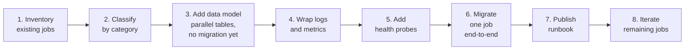

**Step descriptions:**

1. **Inventory existing jobs** — list every background job currently running in the system, including scheduled tasks, queue workers, and event-driven processors. Add each as a row in `background_jobs_compliance.md` with status ⚠️ Grandfathered.
2. **Classify by category** — assign each job a Category 1–6 per §8. This determines its target migration wave from §35.2.
3. **Add data model (parallel tables, no migration yet)** — deploy the `background_job*` tables from §21 alongside existing tables. Do not migrate data yet. New jobs begin writing to these tables immediately.
4. **Wrap logs and metrics** — instrument existing jobs with the standard log envelope (§27) and Prometheus metrics (§27). This is a non-breaking additive change that can be done before full migration.
5. **Add health probes** — deploy the `/healthz/jobs` endpoint (§29) so worker health is visible before any job logic changes occur.
6. **Migrate one job end-to-end** — select the highest-priority grandfathered job (by wave deadline), apply all required changes (idempotency key, distributed lock, standard retry policy, runbook), and mark it ✅ Compliant in the ledger. Use the rollback strategy in §35.6 throughout.
7. **Publish runbook** — publish the job's operational runbook per §33 before the migrated job goes to production. The runbook is a deployment prerequisite, not an afterthought.
8. **Iterate remaining jobs** — repeat steps 6–7 for each remaining grandfathered job in wave-priority order until all rows in the ledger show ✅ Compliant.

### 35.4 Compliance Ledger

Every BAPS system that runs background jobs MUST maintain a file named `background_jobs_compliance.md` in the root of its application repository. This file is the authoritative record of that system's compliance state with ORG-STANDARD-002.

The ledger has two mandatory tables: a **Jobs** table with one row per background job, and a **Migration Progress** table tracking wave completion. The ledger must be updated in the same pull request that creates or modifies any background job. A pull request that adds or changes a background job without updating the ledger is not mergeable.

The canonical template is provided at `org_standards/templates/background-jobs-compliance-template.md`. Each system copies this template into its own repository and populates it. The template must not be modified; system-specific notes go in an optional Notes column added after Owner.

**Jobs table columns:**

| Job Name | Category | Status | Non-Compliance Reasons | Target Wave | Owner |
| --- | --- | --- | --- | --- | --- |
| The unique job identifier used in logs and metrics | 1–6 per §8 | ✅ Compliant, ⚠️ Grandfathered, or 🔴 Non-Compliant | Free-text description of what is missing, or — if compliant | Wave 0–4 from §35.2, or — if already compliant | @team or @person responsible for migration |

### 35.5 Worked Migration Examples

#### Example A: Sampark Hangfire Job → Category 1 Compliant

**Context:** Sampark uses Hangfire for background email dispatch. The `SendMembershipRenewalReminder` job is Category 1 (Scheduled/Cron). It was created before this standard and has no idempotency key, uses Hangfire's default retry policy (10 attempts), and logs in a non-standard format.

**Migration steps:**

1. **Add job row on enqueue.** At the point where Hangfire enqueues the job, write a row to `background_job` (§21) with `job_type = 'membership_renewal_reminder'`, `job_key = SHA-256(member_id + renewal_cycle_id)`, and `status = 'PENDING'`, per §15.2's atomic-insert step (`ON CONFLICT (job_key) DO NOTHING`).
2. **Wrap job body with the §15.2 status-check guard.** At the start of the job handler, acquire a distributed lock keyed on `bg:lock:membership_renewal_reminder:<job_key>` (§12). After acquiring the lock, re-read the `background_job` row's `status` per §15.2: if `SUCCEEDED`, release the lock and return without processing; if `FAILED` or `DLQ`, this is a legitimate retry — reset the row to `PENDING`, increment `attempts`, and proceed with the handler; if `PENDING` or `RUNNING`, another worker already owns this key — release the lock and return without processing.
3. **Apply standard log envelope and metrics.** Replace Hangfire's implicit logging with the structured log envelope (§27): emit `job.started`, `job.completed`, or `job.failed` events with `job_id`, `job_type`, `attempt_number`, `duration_ms`, and `correlation_id` fields. Increment `bg_job_processed_total` and record `bg_job_duration_seconds` per §27.
4. **Deploy `/healthz/jobs` endpoint.** Add the health probe (§29) to the Sampark worker process so that the Category 1 job's queue depth and last-run timestamp are visible to the infrastructure team.
5. **Apply standard retry policy and publish runbook.** Override Hangfire's default 10-attempt retry: set `MaximumRetryCount = 0` on the job attribute (§26 Hangfire guide) so retry is controlled exclusively by the standard policy in §13. Publish the operational runbook per §33 before deploying to production. Update the compliance ledger row to ✅ Compliant.

#### Example B: MyBKY SQS Worker → Category 4 Compliant

**Context:** MyBKY uses an SQS-backed worker to process user preference sync events. The job is Category 4 (Event-Reactive). It has no DLQ configured, does not extract `traceparent` from the SQS message attribute, has no DLQ persistence table, and does not autoscale.

**Migration steps:**

1. **Configure SQS redrive policy and DLQ.** Add a DLQ to the SQS queue with `maxReceiveCount = 3` (§26.4). The DLQ must be a separate SQS queue with a retention period of 14 days. The IAM role for the worker must have `SQS:SendMessage` permission on the DLQ so that the SQS service can move poison messages automatically.
2. **Extract `traceparent` and propagate to MDC.** In the message handler, read the `traceparent` SQS message attribute (§18) before processing begins. Parse it as a W3C Trace Context header and inject the `trace_id` and `span_id` into the logging MDC so that all log lines emitted during processing carry the distributed trace context.
3. **Add DLQ persistence table.** Deploy the `background_job_dlq` table (§21) and wire the worker's dead-letter handler to insert a row whenever a message is moved to the DLQ. This provides a queryable audit trail and enables admin replay without manual SQS console access.
4. **Deploy KEDA ScaledObject.** Define a KEDA `ScaledObject` (§25) targeting the SQS queue, with `minReplicaCount = 1`, `maxReplicaCount = 10`, and `targetQueueLength = 50`. This enables the worker to autoscale under load without manual intervention, meeting the Category 4 autoscaling requirement.
5. **Add admin replay endpoint.** Implement the `/admin/jobs/dlq/replay` endpoint (§10) so that operations staff can replay DLQ messages without SQS console access. The endpoint must be authenticated, authorization-gated to the ops role, and must emit an audit log entry per §34.7. Update the compliance ledger row to ✅ Compliant.

#### Example C: EMS Redis Streams Worker (Already Substantially Compliant)

**Context:** EMS uses Redis Streams to process event publication jobs. The worker already uses idempotency keys, distributed locks, and a retry cap. It is substantially compliant but has three gaps: log field names do not match the standard log envelope (§27), it does not write `background_job_progress` rows for long-running jobs (§21), and it has no published runbook.

**Migration steps:**

1. **Rename log fields to match the standard envelope.** Update the structured log output to use the canonical field names from §17: rename the existing `eventId` field to `job_id`, `eventType` to `job_type`, `processingDurationMs` to `duration_ms`, and `traceId` to `correlation_id`. This is a non-breaking change from a system perspective but required for cross-system log aggregation and alerting.
2. **Add `background_job_progress` rows for long-running jobs.** For any EMS job that runs longer than 30 seconds, instrument the handler to write a `background_job_progress` row (§21) at each major processing milestone (e.g., after each batch of events is committed). This enables the health probe and monitoring dashboards to report meaningful progress rather than a binary pending/completed status.
3. **Publish runbook per §33 template.** Author and publish the operational runbook for the EMS Redis Streams worker using the template at `org_standards/templates/runbook-template.md`. The runbook must cover DLQ inspection, manual replay, consumer group lag investigation, and escalation contacts. Publish the runbook before the next production deployment. Update the compliance ledger row to ✅ Compliant.

### 35.6 Rollback Strategy

Every job migration must be conducted behind a feature flag so that the pre-migration handler can be restored instantly without a code deployment if the migrated version exhibits unexpected behaviour in production.

**Protocol:**

- Before deploying the migrated job handler, introduce a feature flag named `bg.job.<name>.v2` (where `<name>` is the job's `job_type` identifier from §17). The flag is evaluated at the start of the job handler dispatch.
- When the flag is **on**, the new standard-compliant handler executes.
- When the flag is **off**, the pre-migration handler executes unchanged. Flipping the flag off is the complete rollback; no code deployment or database change is required.
- The feature flag must remain in place for a minimum of **30 days** of clean production operation after the migrated handler is promoted to production. "Clean" means no unhandled errors, no DLQ spikes, and no SLA breaches attributable to the migration.
- After 30 days of clean operation, remove the flag evaluation and delete the pre-migration handler code. This removal must happen in a separate pull request from the migration itself, and the compliance ledger row must be updated to confirm the flag has been removed.

---

## 36. Implementation Checklist

This checklist is a gate for code review. A pull request introducing or migrating a background job must satisfy all applicable items before merge. Items marked "if applicable" are required only when the condition stated in the item applies.

### 36.1 Design Phase

- [ ] Job classified under §8 category; rationale documented
- [ ] Technology selected per §23; any deviation has an ADR
- [ ] Idempotency strategy defined (§15): business-key or job-key approach specified
- [ ] Retry policy defined per §7; any overrides from the baseline are justified
- [ ] Timeout and deadline defined (§7 Design Principle 5; envelope `deadline` field §17.1; `background_job.deadline` column §21.1)
- [ ] DLQ contract designed with reason codes per §21
- [ ] Status API surface defined (§10)
- [ ] If Category 5: priority tier chosen (§13), queue lanes designed (§14)
- [ ] Payload size checked; claim-check pattern applied if payload exceeds 256 KB (§20)
- [ ] Dependencies on other jobs mapped (§11)
- [ ] Distributed lock strategy chosen if the job is concurrency-sensitive (§12)

### 36.2 Development Phase

- [ ] Serialization uses safe patterns per §19 (no polymorphic type discriminators, no runtime `Type` fields in payload)
- [ ] Job envelope includes `traceparent`, `correlationId`, and `schemaVersion` fields (§17, §18)
- [ ] Logs use the standard structured log envelope (§27)
- [ ] Standard metrics emitted: enqueue count, processing duration, failure count, DLQ depth (§27)
- [ ] Feature flag(s) wired for the job handler (§30)
- [ ] Health probe endpoints implemented and returning correct status codes (§29)
- [ ] Data model tables (`background_job`, `background_job_progress`, `background_job_dlq`) populated per §21
- [ ] Correlation ID propagated end-to-end from enqueue through handler through downstream calls (§18)

### 36.3 Testing Phase

- [ ] Unit tests cover: happy path, retry-able error, non-retry-able error, timeout, and poison message scenarios
- [ ] Integration tests use LocalStack or Testcontainers per §32 (no mocking of the broker itself)
- [ ] Idempotency test: same message replayed 3× produces exactly one side effect (§15)
- [ ] Load test executed per the applicable test type(s) (stress, spike, soak, and/or volume) and workload model in §31.4; report attached to pull request. Full methodology, prerequisites, and report requirements are per §31.4, which this checklist item does not restate.
- [ ] Chaos test executed for Category 4/5 jobs: broker outage, database outage, and worker OOM (§31)
- [ ] DLQ replay tested against staging environment; results documented

### 36.4 Deployment Phase

- [ ] KEDA `ScaledObject` configured with min/max replicas set per §14 and §25
- [ ] Alerts wired to on-call rotation (§27); alert thresholds reviewed
- [ ] Runbook published per §33 template; link added to Grafana dashboard
- [ ] Compliance ledger updated (§35.4) with job name, owner, and checklist confirmation
- [ ] Rollback feature flag operational; flag must remain active for a minimum of 30 days of clean production operation (§35.6)

---

## 37. Known Limitations & Not-Solved

This section names topics that are explicitly outside the scope of this standard. If your use case requires any of the items below, either wait for the referenced future standard or file an ADR documenting why this standard does not apply and how the gap will be addressed.

### 37.1 Out-of-Scope Topics

| Topic | Reason | Where to look |
| --- | --- | --- |
| Workflow orchestration / Sagas | Warrants its own standard covering compensation, saga log, and orchestrator design | ORG-STANDARD-003 |
| Exactly-once delivery | Impossible in distributed systems at the broker layer; the correct model is at-least-once delivery plus idempotency | §15 |
| Cross-region job routing | No current BAPS system is active-active multi-region; the design assumptions here are single-region | Revisit when multi-region is required |
| Stateful stream processing (windowed aggregations, joins) | Requires dedicated stream processors such as Flink or Kinesis Data Analytics; out of scope for queue-based job design | Future standard if needed |
| CDC as job source | Debezium and DMS pipeline design itself is out of scope; this standard governs what happens after the CDC event is enqueued | Reference material only |
| Temporal | Evaluated and dropped by BAPS in 2024; workflow engine concerns are deferred to ORG-STANDARD-003 | Do not reintroduce without CTO approval |
| Distributed transactions (2PC / XA) | Deliberately excluded; the standard's consistency model is eventual consistency via idempotent at-least-once | Unlikely to reintroduce |
| Tenant isolation beyond queue naming | Not required today; current BAPS deployment is not shared multi-tenant infrastructure | Revisit if shared multi-tenant infra is introduced |
| Job-level cost / chargeback metrics | Awaits a BAPS FinOps standard; individual systems may track this locally but there is no org-wide model yet | Future work |
| BAPS-wide unified job dashboard | Each technology provides its own observability tooling (Hangfire Dashboard, SQS console, Grafana); a unified cross-system dashboard is system-owned | System-owned |

### 37.2 Revisit-Eligible Items

The following topics were deferred during the authoring of this standard. They may be revisited after ORG-STANDARD-002 and ORG-STANDARD-003 have stabilised and at least two BAPS systems have completed their migration checklists:

- Cross-region job routing — when a BAPS system moves to an active-active multi-region deployment
- Tenant isolation beyond queue naming — if BAPS infrastructure evolves to a shared multi-tenant model
- Job-level cost / chargeback metrics — once a FinOps standard is in place to define the reporting schema
- Stateful stream processing — if a BAPS system adopts windowed aggregations or join semantics at scale

---

## 38. References & Related Standards

### 38.1 Internal Documents

| Type | ID / Path | Relationship |
| --- | --- | --- |
| Standard | ORG-STANDARD-001 (Redis Auth Cache Design) | This standard may share the same Redis cluster; key namespaces must remain separate per §6 of ORG-STANDARD-001 |
| Standard | ORG-STANDARD-003 (Workflow Orchestration & Sagas) | Extends this standard for multi-step workflows that require compensation and saga log |
| Reference TDD | `references/background_processes/sampark_tdd/` | Sampark Hangfire pattern; primary source for Category 1-3 design decisions in this standard |
| Reference TDD | `references/background_processes/mybky_tdd/` | MyBKY SQS + EventBridge pattern; primary source for Category 4-5 broker design |
| Reference TDD | `references/background_processes/ems_tdd/` | EMS Redis Streams pattern; source for Category 4-5 Redis Streams consumer group design |
| Reference TDD | `references/background_processes/gms_tdd/` | GMS high-throughput dispatch pattern; source for Category 5 priority lane and KEDA scaling design |

### 38.2 External References

- AWS SQS Developer Guide — queue configuration, visibility timeout, message retention, and DLQ setup
- Amazon EventBridge Documentation — event bus routing rules, archive and replay, and cross-account patterns
- Redis Streams / Consumer Groups Documentation — XADD, XREADGROUP, XACK, and consumer group mechanics
- KEDA Documentation (keda.sh/docs) — ScaledObject specification, scaler catalogue, and scaling metrics
- Hangfire Documentation (docs.hangfire.io) — job storage, recurring jobs, retry policies, and dashboard configuration
- Spring Cloud AWS Documentation — SQS listener container, acknowledgement modes, and message conversion
- Spring Batch Documentation — job and step lifecycle, partitioning, restart, and skip logic
- W3C Trace Context Specification (w3.org/TR/trace-context) — `traceparent` and `tracestate` header formats referenced in §18
- OpenTelemetry Specification — metrics, traces, and logs signal definitions referenced in §27
- CNCF Serverless Workflow (informative; not adopted) — reviewed during standard authoring; not adopted due to lack of BAPS runtime support

### 38.3 Industry Patterns Referenced

- Transactional Outbox (Chris Richardson, microservices.io) — foundation for the enqueue-in-transaction pattern described in §24
- Claim-Check (Enterprise Integration Patterns, Hohpe & Woolf) — pattern for externalising large payloads referenced in §20
- Competing Consumers (Enterprise Integration Patterns) — pattern underpinning horizontal worker scaling described in §14 and §25
- Circuit Breaker (Nygard, *Release It!*) — pattern referenced in §7 for protecting downstream dependencies during worker retry storms
- Poison Message / Dead Letter Channel (Enterprise Integration Patterns) — pattern formalised in §21 and §22 for unreprocessable message handling

---

## 39. Appendix A — End-to-End Walkthroughs

Six walkthroughs, one per category, showing this standard in action from enqueue to completion. Each walkthrough includes a mermaid sequence diagram, a description of the compliance touchpoints, and a mapping to specific sections of this standard.

---

### 39.1 Category 1 — Monthly Attendance Report (Sampark, Java)

**Scenario.** A Spring `@Scheduled` job fires at 02:00 every month. Sampark must generate one PDF attendance report per cluster and upload it to S3. The job must not run concurrently across multiple pods. If a pod crashes mid-run, the next scheduled trigger must resume without duplicating PDFs already uploaded.

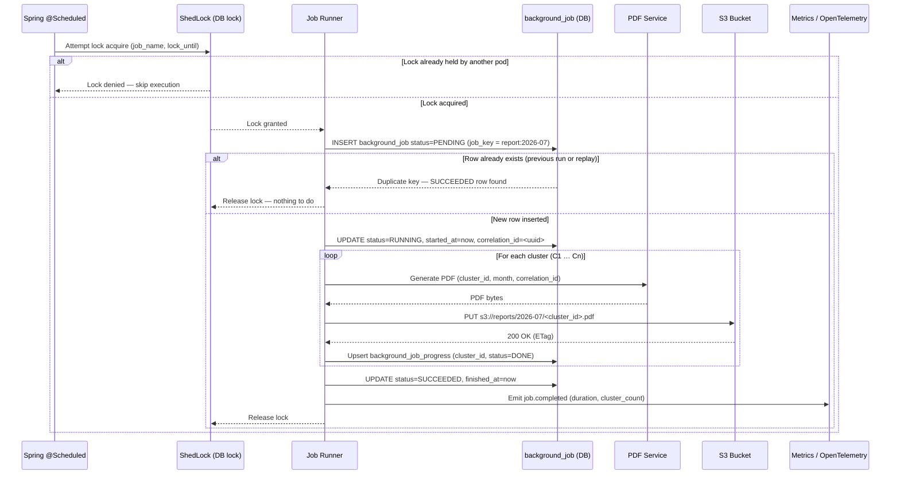

**Compliance touchpoints:**

- §12 Distributed lock — ShedLock acquires a row lock in the database before execution; only one pod runs at a time.
- §15 Job-key idempotency — `job_key = report:2026-07` ensures a second trigger within the same month finds a SUCCEEDED row and exits without re-generating PDFs.
- §21 Data model — `background_job` row tracks status lifecycle; `background_job_progress` records per-cluster completion so a resumed run skips already-uploaded clusters.
- §18 Correlation ID propagation — a `correlation_id` UUID is set on the `background_job` row and forwarded to the PDF Service and S3 object metadata.
- §27 Metrics — `job.completed` counter with duration and cluster count emitted via OpenTelemetry on success; `job.failed` emitted on unhandled exception.
- §33 Runbook — the runbook covers how to manually release a stuck ShedLock row and how to force a single-cluster retry via `background_job_progress` deletion.

---

### 39.2 Category 2 — Welcome Email After Signup (MyBKY, .NET)

**Scenario.** When a new devotee completes signup in the MyBKY API, a welcome email must be sent via SES. Email delivery must not be lost if the API pod crashes after committing the signup row. The worker must not send the email more than once even if the SQS message is delivered twice.

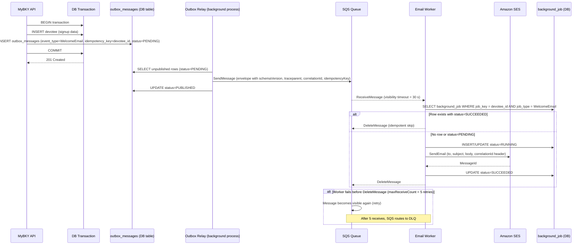

**Compliance touchpoints:**

- §24 Transactional outbox — the API writes the signup row and the outbox row in a single database transaction; the Relay publishes only after commit, eliminating the dual-write race condition.
- §15 Business-key idempotency — `job_key = devotee_id` in the `background_job` row; a second delivery of the same SQS message finds a SUCCEEDED row and deletes without re-sending.
- §17 Job envelope — the SQS message body includes `schemaVersion`, `traceparent`, `correlationId`, and `idempotencyKey` fields per the standard envelope schema.
- §7 Retry with `maxReceiveCount=5` — the SQS queue's redrive policy is set to five receive attempts before routing to the DLQ; each retry re-enters the idempotency check.
- §21 Data model — `background_job` row records `job_type=WelcomeEmail`, `job_key=devotee_id`, status lifecycle, and `correlation_id` for traceability.

---

### 39.3 Category 3 — CSV Import of 50 000 Devotees (Sampark, Java)

**Scenario.** An administrator uploads a CSV file containing 50 000 devotee records via the Sampark admin API. Processing takes several minutes. The admin must be able to poll for progress and see a final success or failure result. The CSV file is too large to embed in a job payload.

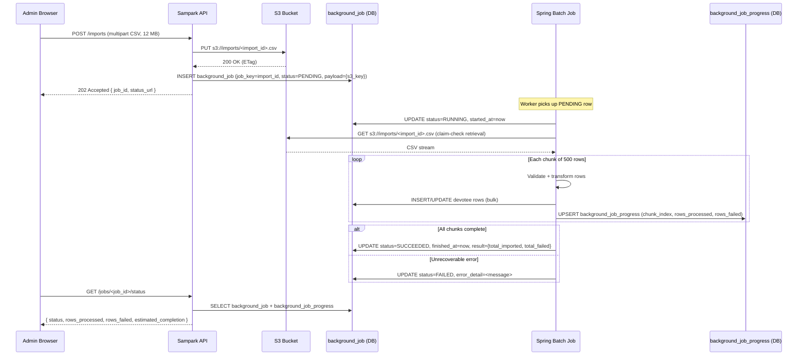

**Compliance touchpoints:**

- §10 Status API — the `/jobs/<job_id>/status` endpoint is the standard polling contract; it returns status, progress counters, and `estimated_completion` derived from throughput so far.
- §7 Design Principle 5 / §21.1 Deadline — the job is created with a `background_job.deadline` timestamp; the batch job self-cancels if the deadline passes, and the status API reflects this as `status=FAILED` with `error.code=deadline_exceeded` in the existing §10.4 status body — there is no separate top-level `deadline_exceeded` field.
- §20 Claim-check pattern — the 12 MB CSV is stored in S3 at enqueue time; only the S3 key is carried in the `background_job` payload, keeping the job row small.
- §21 Data model — `background_job` holds top-level status and the final aggregate result; `background_job_progress` holds one row per chunk with per-chunk `rows_processed` and `rows_failed` counters for real-time progress display.

---

### 39.4 Category 4 — Attendance Recorded → Update Cluster Stats (EMS, Java)

**Scenario.** A devotee scans their badge at an EMS event. The mobile API records attendance and publishes an event to a Redis Stream. Two worker instances (W1, W2) share a consumer group to update cluster statistics. W2 crashes mid-processing, leaving its in-flight message unclaimed. W1 reclaims and processes it; the idempotency check detects the replay and skips duplicate work.

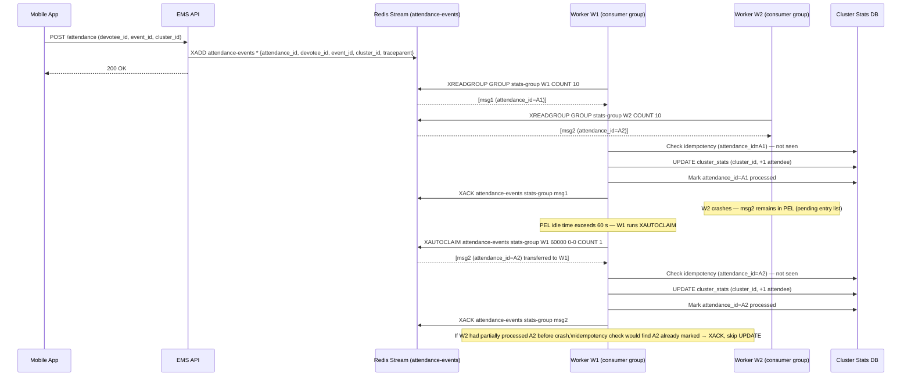

**Compliance touchpoints:**

- §26.6 Redis Streams — `XADD` for enqueue, `XREADGROUP` for competing-consumer delivery, `XACK` for acknowledgement, and `XAUTOCLAIM` for reclaiming messages from a crashed consumer.
- §15 Business-key idempotency — `attendance_id` is the business key stored in the processed-events table; a reclaimed message that was partially handled before the crash is detected and skipped without re-applying the cluster stats update.
- §12 No distributed lock required — the Redis Streams consumer group guarantees that each message is delivered to exactly one consumer at a time within the group, eliminating the need for a separate distributed lock.
- §18 Correlation ID — `traceparent` is carried in the stream message payload and forwarded to all downstream DB writes for end-to-end trace linkage.

---

### 39.5 Category 5 — GMS-Style OTP Message Dispatch

**Scenario.** GMS dispatches OTP and transactional SMS messages for multiple BAPS systems. Messages arrive at five priority tiers (CRITICAL through HOUSEKEEPING). Each tier has a dedicated queue and worker pool. All workers share a token-bucket rate limiter enforcing the SMS provider's API limit. KEDA scales each worker pool independently based on queue depth.

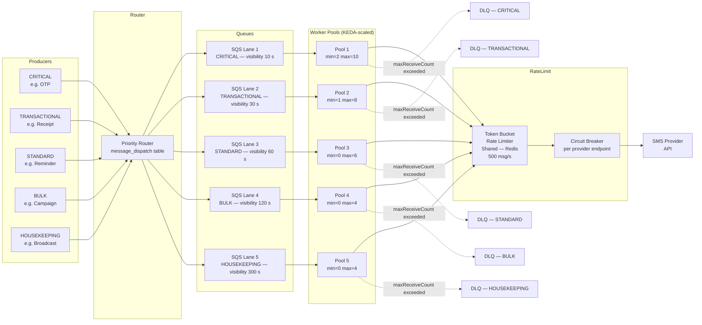

**Compliance touchpoints:**

- §14 Priority lanes — five SQS queues, one per priority tier, with visibility timeouts decreasing for higher-priority lanes (CRITICAL = 10 s, HOUSEKEEPING = 300 s); higher-priority workers maintain higher minimum replica counts.
- §25 KEDA per-lane scaling — each worker pool has its own `ScaledObject` referencing its lane's SQS queue depth; CRITICAL/TRANSACTIONAL pools have `minReplicaCount > 0` to ensure sub-second startup for critical messages.
- §14.2 Token-bucket rate limiter — all worker pools acquire tokens from a shared Redis-backed token bucket before calling the SMS provider API, enforcing the provider's 500 msg/s ceiling across the entire fleet.
- §16 Circuit breaker — a per-endpoint circuit breaker opens after consecutive provider timeouts, failing fast and allowing the token bucket to refill before retrying; this prevents retry storms from amplifying a partial provider outage.
- §21 Data model — `message_dispatch` records one row per outbound message with `lane`, `status`, and `correlation_id`; `message_delivery_event` records each delivery attempt (timestamp, provider response code, latency) for audit and SLA reporting.

---

### 39.6 Category 6 — Warm Lookup Cache on Startup (Sampark, Java)

**Scenario.** The Sampark API serves state and district lookups from an in-memory cache. On pod startup, Spring must load the full lookup tables from the database before the pod accepts traffic. Kubernetes must not route requests until the cache is fully populated.

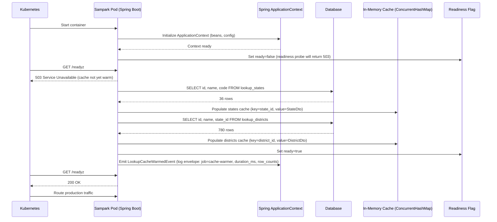

**Compliance touchpoints:**

- §29 Readiness gate — the `/readyz` endpoint returns 503 until the readiness flag is set to `true`; Kubernetes does not route traffic to the pod until the cache is fully populated, preventing requests from hitting an empty cache.
- §6 No external dependencies beyond DB — the cache warmer only queries the primary database; it does not call any external APIs, message brokers, or downstream services during startup, ensuring the warmup cannot be blocked by an unrelated outage.
- Not persisted to `background_job` — the cache warmer is a short-lived, synchronous startup routine tied to the pod lifecycle; it does not represent a business-domain job and is therefore not tracked in the `background_job` table.
- §27 Structured log envelope — on successful completion, the warmer emits a single structured log event with fields `job=cache-warmer`, `duration_ms`, `states_loaded`, and `districts_loaded`; this log line is the sole audit trail for the warmup.

---

## 40. Appendix B — Common Anti-Patterns

The following anti-patterns are consolidated from all sections of this standard. Each entry identifies a pattern that has been observed or anticipated in BAPS implementations, explains why it is wrong, and states the correct approach. Reviewers must reject pull requests that introduce any of these patterns.

### 40.1 Enqueue & Delivery

| Anti-Pattern | Why Wrong | Correct Approach |
| --- | --- | --- |
| Enqueuing a message after commit in the same database transaction | The broker call happens after commit; a crash between commit and enqueue drops the message silently with no retry path | Use the transactional outbox pattern (§24): write the outbox row inside the same transaction; a relay process publishes from the outbox after commit |
| Using the database as a message queue (`SELECT ... FOR UPDATE` polling) | Polling under load creates lock contention and table bloat; does not scale horizontally; adds latency proportional to poll interval | Use a purpose-built broker: SQS for at-least-once, Redis Streams for ordered low-latency (§22) |
| Passing a payload larger than 256 KB inline in the message body | Exceeds SQS hard limits; large payloads inflate broker cost, increase serialization latency, and make retries expensive | Apply the claim-check pattern (§20): store the payload in S3/object storage and pass only the reference in the message |
| Assuming message order in SQS Standard queues | SQS Standard offers best-effort ordering only; messages can arrive out of order under load or after retries | Use SQS FIFO if strict ordering is required, or design handlers to be order-independent and idempotent |

### 40.2 Retry & Failure

| Anti-Pattern | Why Wrong | Correct Approach |
| --- | --- | --- |
| Retrying indefinitely without a dead-letter queue | Poison messages consume worker capacity forever and block healthy messages behind them | Configure a bounded retry count with exponential back-off and route exhausted messages to a DLQ for inspection (§7, §21) |
| Retrying non-idempotent operations | Duplicate execution of non-idempotent operations (charges, emails, writes) produces duplicate side effects visible to users | Implement idempotency (§15) before enabling retries; retries are only safe when the handler is idempotent |
| Silent `try/catch` that swallows exceptions | Errors are lost; the job appears successful; the underlying problem goes undetected and unalerted | Log the exception with the full structured envelope (§27), then rethrow or route explicitly to the DLQ |
| Retrying on HTTP 4xx responses from downstream | Client errors (400, 401, 403, 404, 422) indicate a problem with the request that will not resolve by retrying | Classify errors before retrying (§7): retry transient 5xx and network errors only; send 4xx failures directly to the DLQ without retry |

### 40.3 Idempotency

| Anti-Pattern | Why Wrong | Correct Approach |
| --- | --- | --- |
| Using a random UUID as the idempotency key | Each retry generates a new random key; the idempotency store treats each attempt as a distinct request, producing duplicates | Derive the key deterministically from stable message attributes (§15): e.g., `SHA-256(queue_name + message_id + entity_id)` |
| Checking the idempotency store without an atomic guard | A race between the existence check and the insert allows two concurrent workers to both see "not processed" and both execute | Use a `UNIQUE` constraint on the idempotency key column so only one insert wins; the loser receives a constraint violation and skips execution (§15) |
| Assuming the message broker delivers each message exactly once | No commonly used broker provides exactly-once delivery; SQS, Redis Streams, and Kafka all operate at-least-once under failure conditions | Design every handler for at-least-once delivery with idempotency (§15); do not rely on broker guarantees to prevent duplicates |

### 40.4 Observability

| Anti-Pattern | Why Wrong | Correct Approach |
| --- | --- | --- |
| Logging `logger.info("Failed")` with no structured context | The log line is unsearchable; on-call engineers cannot determine which job, which entity, or which attempt failed | Emit every log line with the full structured envelope (§27): `job_type`, `job_id`, `attempt`, `correlation_id`, `duration_ms`, and error details |
| Not propagating trace context across worker hops | Distributed traces break at the worker boundary; it is impossible to correlate a background failure with the originating HTTP request | Extract the W3C `traceparent` header from the message envelope on dequeue and inject it into the worker's trace context (§18) |
| Emitting no metrics on job success or failure | There is no signal to drive alerts, SLO burn-rate calculations, or capacity planning | Instrument every worker with standard counters and histograms (§27): `jobs_executed_total`, `jobs_failed_total`, `job_duration_seconds` with `job_type` and `status` labels |
| Alerting on error rate but not on queue age or lag | A surge of new messages without corresponding failures produces no alert; backlogs grow silently until latency SLOs are breached | Alert on both error rate and queue age / consumer lag (§27); a growing DLQ depth or aging oldest-message timestamp indicates a stalled consumer |

### 40.5 Concurrency & Locking

| Anti-Pattern | Why Wrong | Correct Approach |
| --- | --- | --- |
| Running a cron job on every replica without a distributed lock | All replicas fire simultaneously; the same job executes N times, producing duplicate writes, duplicate notifications, or double-spending | Use a distributed lock or leader-election mechanism (§12), such as ShedLock or a Redis `SET NX PX` lease, so only one replica executes per tick |
| Holding a database row lock for the full duration of a long job | Long-held locks prevent other transactions from reading or writing the same row; under concurrent load this causes deadlocks and cascading timeouts | Keep individual transactions short (§12); use advisory locks scoped to the critical section only, and release immediately after the protected check-and-update completes |
| Not renewing a message lease during a long-running job | The broker's visibility timeout expires before the job completes; the broker redelivers the message to another worker, causing concurrent duplicate execution | Extend message visibility (SQS `ChangeMessageVisibility`) or re-XCLAIM the Redis Streams entry (§26.6) on a heartbeat interval well before the visibility timeout expires |

### 40.6 Serialization & Security

| Anti-Pattern | Why Wrong | Correct Approach |
| --- | --- | --- |
| Using `BinaryFormatter` (C#) or `ObjectInputStream` (Java) to deserialize untrusted message payloads | Both mechanisms execute arbitrary type constructors during deserialization; a crafted payload can achieve remote code execution (RCE) | Deserialize only JSON or another text-based format using a schema-validated parser with strict type mapping (§19); never deserialize binary object graphs from broker messages |
| Setting `TypeNameHandling.All` in Newtonsoft.Json | Enables deserialization gadget chains; an attacker who controls the `$type` field can instantiate arbitrary .NET types and execute code | Set `TypeNameHandling.None` (the default) and use explicit discriminated-union fields or envelope `event_type` to determine the concrete type (§19) |
| Omitting a `schemaVersion` field from the message envelope | When the producer upgrades its schema, consumers cannot distinguish old from new payloads; deserialization silently truncates or misinterprets fields | Include `schemaVersion` in every envelope (§17); consumers branch on version to apply the correct deserialization and migration path |

### 40.7 Testing

| Anti-Pattern | Why Wrong | Correct Approach |
| --- | --- | --- |
| Testing the worker exclusively with mocks | Mocks do not exercise broker serialization, queue configuration, dead-lettering, or retry behaviour; bugs in these integration points are discovered only in production | Run at least one integration test against a real broker process (LocalStack for SQS, Testcontainers for Redis Streams) that validates round-trip enqueue, process, and DLQ routing (§32) |
| Not writing an explicit idempotency test | Duplicate-message handling is untested; a regression in the idempotency guard ships undetected | Write a test that delivers the same message twice and asserts the side effect occurs exactly once (§36.3) |
| Not writing any chaos or failure-injection test | Failure modes (broker down, DB timeout, OOM kill mid-job) are discovered in production incidents rather than in CI | Include at least one chaos scenario per worker type: simulate broker unavailability, database timeout, and process kill mid-execution; verify the job is retried and completed correctly (§31) |

### 40.8 Operations

| Anti-Pattern | Why Wrong | Correct Approach |
| --- | --- | --- |
| Deploying a worker with no runbook | On-call engineers have no documented escalation path, no known remediation steps, and no context at 3 AM | Every worker deployment must include a runbook covering queue drain procedure, DLQ triage steps, kill-switch activation, and escalation contacts (§33) |
| Deploying without a kill-switch | A defective deploy cannot be stopped without a full rollback or redeployment, during which the bad worker continues processing | Wrap the processing loop with a feature flag checked before each dequeue (§30); disabling the flag stops processing immediately without a code change or redeployment |
| Operating with no readiness probe or a broken one | Kubernetes routes traffic or assigns work to pods that are not yet ready (cold cache, incomplete startup); initial requests fail | Implement a `/readyz` endpoint (§29) that returns 503 until all startup prerequisites are satisfied (cache warm, broker connection established); verify it with an integration test |
| Deploying without KEDA or equivalent autoscaling | With a fixed replica count the worker is either overprovisioned at idle or overwhelmed at peak; neither state is cost-efficient or reliable | Configure KEDA (§25) to scale replica count against queue depth or DLQ depth; set minimum replicas to 1 (not zero) for latency-sensitive workers |

---

## 41. Approval & Change Control

### 41.1 Approval Workflow

Adoption of this standard and any revision to it requires sign-off in the following sequence:

| # | Role | Responsibility |
| --- | --- | --- |
| 1 | Author (Principal Architect) | Drafts or revises the standard; confirms technical accuracy |
| 2 | Security Lead | Reviews security controls, threat model coverage, and deviation risk |
| 3 | Infrastructure Lead | Reviews operational requirements, platform compatibility, and cost impact |
| 4 | CTO / Engineering Director | Final ratification; standard becomes enforceable upon this signature |

This standard is **not enforceable** until the CTO / Engineering Director has signed. Systems may begin voluntary adoption before CTO approval but are not obligated to do so. Amendments follow the same four-step approval chain before the revised version becomes enforceable.

### 41.2 Change Control

#### Versioning rules

| Change type | Version increment | Effect on existing implementations |
| --- | --- | --- |
| Breaking change — removes, renames, or contradicts an existing normative requirement | MAJOR (e.g., 1.0 → 2.0) | Existing implementations must update their designs to remain compliant |
| Additive or clarifying change — adds new guidance, extends examples, corrects non-normative text | MINOR (e.g., 1.0 → 1.1) | Existing implementations remain valid; no redesign required |

#### Amendment process

1. Open a pull request against `org_standards/ORG-STANDARD-002-Background-Processing-Design.md` on the `master` branch.
2. State the rationale for the change in the PR description.
3. For MAJOR version increments, include an impact assessment identifying which known implementations are affected and what changes they must make.
4. Obtain approvals in the sequence defined in §41.1.
5. On CTO approval, merge the PR, increment the version in the Document Control table, and add a row to the Change Log (§41.4).

### 41.3 Deviation & ADR

Any system may deviate from one or more sections of this standard by filing an Architecture Decision Record (ADR). The ADR must:

1. Name the specific section(s) of this standard being deviated from.
2. Explain why this standard does not fit the system's context (technical constraint, platform limitation, or cost justification).
3. Propose an alternative approach that meets the underlying goal of the deviated section(s).
4. Be co-signed by the system's Tech Lead, the organisation's Security Lead, and the Infrastructure Lead.

The ADR must be filed in the system's own `docs/adr/` directory. A cross-reference to the ADR (system name, ADR ID, and brief description) must be added to the Change Log of this standard (§41.4) by the Author or Principal Architect at the time of ratification.

Deviations are scoped to the filing system only. A deviation ADR does not amend this standard and does not affect other systems' compliance obligations.

### 41.4 Changelog

| Version | Date | Author | Summary |
| --- | --- | --- | --- |
| 1.0 | 2026-07-15 | Principal Architect | Initial issuance covering job classification, technology selection, retry/error handling, and job status API. |
| 1.1 | 2026-08-18 | Principal Architect | Fixed stale "ORG-STANDARD-003 — planned" references (5 occurrences) and a fabricated §37 citation in §22. See front-matter Change Log for full detail. |
| 1.2 | 2026-08-18 | Principal Architect | Fixed 3 internal contradictions from a holistic audit (Category 3 DLQ granularity, kill-switch refresh interval, REPORTING-lane/severity-label bug). See front-matter Change Log for full detail. |
| 2.0 | 2026-08-18 | Principal Architect | **MAJOR.** Fixed a real idempotency-guard correctness bug (§15.2 unified on `background_job.status`; `background_job_idempotency` renamed/rescoped to `message_dispatch_dedup`, §21.2). Breaking schema change — see front-matter Change Log and updated DBML for full detail. |
| 2.1 | 2026-08-18 | Principal Architect | Fixed 2 terminology/consistency findings from the same audit (§20.4 DLQ-retention figure corrected to match §21's 1-year minimum; §33.3 PagerDuty/Slack severity-scoping cross-reference to ORG-STANDARD-006 §10.3). See front-matter Change Log for full detail. |
| 2.2 | 2026-08-18 | Principal Architect | Added §14.7 Consent Enforcement, closing a six-standard-set gap from the same audit. See front-matter Change Log for full detail. |
| 2.3 | 2026-08-18 | Principal Architect | §26.1's SQL Server ban reworded to state the actual PostgreSQL-standardization policy and grandfathering rationale. See front-matter Change Log for full detail. |
| 2.4 | 2026-08-19 | Principal Architect | §16.2's circuit-breaker thresholds split into External Third-Party Provider and Internal Service-to-Service profiles. See front-matter Change Log for full detail. |
| 2.5 | 2026-08-19 | Principal Architect | Added new §5.3 stating the Kubernetes infrastructure prerequisite, with an ADR escape hatch for non-Kubernetes systems. See front-matter Change Log for full detail. |
| 2.6 | 2026-08-19 | Principal Architect | Fixed 5 findings from a second independent verification pass (stale worked-example idempotency guard, a KEDA min-replica sample corrected + prior "did not reproduce" claim retracted, 2 citation/wording fixes, a cross-standard FK-retention gap with ORG-STANDARD-003). See front-matter Change Log for full detail. |
| 2.7 | 2026-08-20 | Principal Architect | Added new §27.5 Resource-Growth Monitoring for Long-Running Workers, closing catalog challenge `SCP-09`. See front-matter Change Log for full detail. |
| 2.8 | 2026-08-23 | Principal Architect | Fixed 2 findings from an independent verification pass on the v2.7 addition (§27.2 metric-prefix scope, §27.5 OOM-alert citation). See front-matter Change Log for full detail. |
| 2.9 | 2026-08-27 | Principal Architect | Substantially expanded §31.4 Load Test into the canonical stress/spike/soak/volume test-type taxonomy, workload-model disclosure, environment/data prerequisites, baseline run, and report requirements, cross-referenced against BAPS's own RGC/QA load-testing guidelines. See front-matter Change Log for full detail. |
| 2.10 | 2026-08-27 | Principal Architect | Fixed 1 finding from an independent verification pass on the v2.9 addition (§31.4.1's soak-test row rescoped to match §27.5's actual monitored population). See front-matter Change Log for full detail. |
| 2.11 | 2026-08-31 | Principal Architect | Fixed 5 findings from an independent cross-standard-set holistic accuracy review (KEDA diagram min-value fix, §15.4 retention rewrite, §31.1/§36.1 deadline citation fix, §39.3 fabricated field fix, §36.3 stale checklist item). See front-matter Change Log for full detail. |
